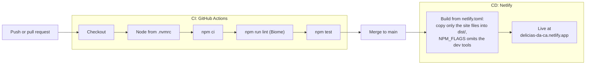

<div align="center">

<a href="https://delicias-da-ca.netlify.app/">
  
</a>

# Delícias da Cá

**A mobile-first online menu for homemade ring cakes in Campinas/SP, where every cake has an "order on WhatsApp" button.**

[delicias-da-ca.netlify.app](https://delicias-da-ca.netlify.app/)

[](https://github.com/juanveronez/delicias-da-ca/actions/workflows/ci.yml)
[](#-getting-started)
[](package.json)
[](#-code-quality)
[](#-testing)
[](#-deployment)

</div>

## Table of contents

- [About](#-about)
- [Features](#-features)
- [Tech stack](#-tech-stack)
- [Project structure](#-project-structure)
- [Getting started](#-getting-started)
- [Editing the menu](#-editing-the-menu)
- [Photos](#-photos)
- [Code quality](#-code-quality)
- [Testing](#-testing)
- [CI/CD](#-cicd)
- [Deployment](#-deployment)
- [Conventions](#-conventions)
- [Known gaps](#-known-gaps)

## 🍰 About

Delícias da Cá sells homemade cakes, mostly *bolos de forma* (ring cakes), with delivery in Campinas/SP. This repository is its online menu: one page that shows the flavours, prices and photos and hands the customer over to WhatsApp, where the order is settled. There is no cart, checkout or payment on the site.

It is plain HTML, CSS and JavaScript on purpose. The menu is a JSON file edited by a single person, so there is no build step, no framework to keep up to date and no runtime dependencies to break (the only dev dependency is the Biome linter). Changing a price means editing one line and pushing.

The site itself is written in Brazilian Portuguese; this README is in English.

## ✨ Features

- One "order on WhatsApp" button per cake, opening a chat with a prefilled Portuguese message that names the cake and its price, plus a general order button at the top.
- The 18 flavours come from [`data/menu.json`](data/menu.json), in display order, with prices formatted by `Intl.NumberFormat('pt-BR')`.
- WebP photos with lazy loading. A cake without a photo (or a photo that fails to load) falls back to a plain brown block instead of a broken image.
- Works without JavaScript or when the menu fails to load: a notice with a WhatsApp button replaces the list.
- Mobile first and accessible: one column on phones and two or three on larger screens, touch targets of at least 44px, button labels that start with their visible text, and a layout that survives enlarged text.
- The menu is revalidated on every visit (`cache: 'no-cache'`), so a new price shows up right after a deploy.
- Link previews for WhatsApp and Instagram through Open Graph tags and [`og-image.jpg`](og-image.jpg).
- 134 tests that need no installed dependencies, including a check that the Netlify build publishes only the site files.
- A CI/CD pipeline: GitHub Actions lints (Biome) and tests every push and pull request, and Netlify publishes whatever reaches `main` (see [CI/CD](#-cicd)). Biome also keeps the code style uniform (see [Code quality](#-code-quality)).

## 🧰 Tech stack

| Area | Choice |
|---|---|
| Page | HTML5, CSS3 and JavaScript ES modules, no framework and no bundler |
| Data | [`data/menu.json`](data/menu.json), read with `fetch` |
| Tests | Node's built-in test runner (`node --test`), Node 22 (the version is in [`.nvmrc`](.nvmrc)) |
| Code quality | [Biome](https://biomejs.dev/) 2.6.4: lint, formatting and import order. The only dev dependency, pinned to an exact version |
| CI | GitHub Actions ([`ci.yml`](.github/workflows/ci.yml)) and Dependabot ([`dependabot.yml`](.github/dependabot.yml)) |
| Images | WebP, converted with `sips` (macOS) and `cwebp` by [`scripts/prepare-photos.mjs`](scripts/prepare-photos.mjs) |
| Local server | `python3 -m http.server` (any static server works) |
| Hosting | [Netlify](https://www.netlify.com/) free plan, configured by [`netlify.toml`](netlify.toml) |

## 📁 Project structure

```text
.
├── index.html                  # the single page: header, notices, menu mount point, how to order
├── favicon.svg                 # tab icon: a ring cake drawn in SVG
├── og-image.jpg                # 1200x630 link-preview image (also the banner above)
├── netlify.toml                # what Netlify builds and publishes, and that it skips the dev tools
├── package.json                # name, "type": "module", the test and lint scripts; Biome is the only dev dependency
├── package-lock.json           # exact dependency versions, used by `npm ci` (locally and in CI)
├── biome.json                  # Biome settings: style, scope and rules
├── .nvmrc                      # Node version, read by `nvm use` and by CI
├── css/
│   └── style.css               # styles, mobile first
├── js/
│   ├── app.js                  # fetches the menu and renders the cards (uses the DOM)
│   └── whatsapp.js             # pure functions: price format, message and WhatsApp link
├── data/
│   └── menu.json               # the cakes, in display order
├── img/                        # optimised WebP photos: <id>.webp and hero.webp
├── scripts/
│   ├── prepare-photos.mjs      # command that turns fotos-originais/ into img/*.webp
│   └── photo-lib.mjs           # pure helpers used by the command
├── tests/                      # node:test suites (*.test.js)
├── docs/superpowers/           # design spec and implementation plan (in Portuguese)
├── .github/
│   ├── workflows/ci.yml        # CI: npm ci, npm run lint, npm test
│   └── dependabot.yml          # weekly pull requests for the actions and for Biome
├── .claude/skills/
│   └── add-cake-photos/        # Claude Code skill for adding photos to the site
└── fotos-originais/            # original photos; git-ignored, exists only on the owner's machine
```

## 🚀 Getting started

Prerequisites:

- Node 22, to run the tests, the linter and the photo converter. The exact version is in [`.nvmrc`](.nvmrc), so `nvm use` picks it. The site itself needs no Node.
- Python 3 (or any static file server) to view the site.
- Only for photo conversion: macOS with `sips` (already there) and `cwebp` (`brew install webp`).

`npm test` needs no install, because it uses only Node's standard library. `npm ci` is only needed to lint or format the code: it installs Biome, the only dev dependency, at the exact version in `package-lock.json`.

```bash
git clone <repository-url>
cd delicias-da-ca
nvm use                       # optional: switches to the Node version from .nvmrc
python3 -m http.server 8000
```

Open <http://localhost:8000>.

A local server is required. Opening `index.html` by double click does not work: browsers block `fetch` and ES modules on `file://` pages, so the page would show the "Cardápio" title and no cakes.

Run the tests with:

```bash
npm test
```

To lint and format the code, see [Code quality](#-code-quality).

## 📝 Editing the menu

Edit only [`data/menu.json`](data/menu.json). Each cake is one entry:

```json
{ "id": "cenoura-vulcao", "name": "Cenoura vulcão", "price": 50, "photo": "cenoura-vulcao.webp" }
```

| Field | Rule |
|---|---|
| `id` | Unique, lowercase, no accents or spaces, words joined by hyphens. It is also the base name of the photo. |
| `name` | Shown on the card and in the WhatsApp message. |
| `price` | A positive number in reais, without the `R$` symbol. |
| `photo` | Always `<id>.webp`, a file in [`img/`](img/). |

After editing, run `npm test`. It catches broken JSON (a stray comma, for example), a `photo` that is not `<id>.webp` and duplicated ids. When you add or remove a flavour on purpose, the test `menu.json has the expected number of cakes` fails: update the `EXPECTED_COUNT` constant in [`tests/menu.test.js`](tests/menu.test.js).

A new flavour also needs its photo (see below). Without it nothing breaks: the card shows a brown block and `npm test` lists the cake as missing a photo.

## 📸 Photos

Rules for the published files: one photo per cake at `img/<id>.webp`, long side up to 800px (`img/hero.webp`, the photo at the top of the page, up to 1200px), at most 200 KB and no EXIF or XMP metadata.

Workflow:

1. Put the originals in `fotos-originais/` (git-ignored), one file per photo, named after the cake id: `cenoura-vulcao.jpg`. The top photo is `hero.jpg`. `.jpg`, `.jpeg`, `.png` and `.heic` work.
2. Convert:

```bash
node scripts/prepare-photos.mjs --dry-run   # show the plan, write nothing
node scripts/prepare-photos.mjs             # convert fotos-originais/ into img/
```

3. Open every file in `img/` and check the flavour, the rotation and the crop before committing.

For each photo the command crops black bars from screenshots (only bars of 4px or more), applies the rotation stored in the metadata, never upscales, and writes a WebP at quality 80 without metadata. It refuses a result over 200 KB or with EXIF/XMP, skips files whose name is not a cake id, stops before converting anything if two files claim the same id, and never changes the originals. Writes are atomic, so an interrupted run leaves no half-written photo.

| Option | Effect |
|---|---|
| `[sourceDir]` | Folder with the originals (default `fotos-originais`). |
| `--out <dir>` | Folder for the WebP files (default `img`). |
| `--dry-run` | Show what would be done and write nothing. |
| `--no-crop` | Do not remove black bars from any photo. |
| `--no-crop=<id>,<id>` | Same, for the listed ids only. Use it when the background is near black (a cake on a dark cloth looks like a bar to the detector). |

The exit code is 0 when nothing failed, 1 when a photo failed or an id is duplicated, and 2 for usage errors or missing tools. `node scripts/prepare-photos.mjs --help` lists everything.

Running the command on the whole folder rewrites photos that are already published. To convert only new ones, copy them to a temporary folder and use it as the source:

```bash
NEW=$(mktemp -d)
cp fotos-originais/fuba.jpg "$NEW"
node scripts/prepare-photos.mjs "$NEW"
rm -r "$NEW"
```

To have Claude Code do all of this, drop the new photos in the project root or in `fotos-originais/` and ask it to put them on the site. The project skill [`add-cake-photos`](.claude/skills/add-cake-photos/SKILL.md) matches each picture to a cake, converts only the new files, checks the result and commits them by path.

## 🧹 Code quality

[Biome](https://biomejs.dev/) checks the code style, so a diff shows what changed and not how somebody's editor is set up. It is the project's only dev dependency, pinned to an exact version in [`package.json`](package.json) and locked in `package-lock.json`.

```bash
npm ci                # once: installs Biome (npm test does not need it)
npm run lint          # read-only: lint rules, formatting and import order; exits non-zero on any problem
npm run lint:fix      # applies the safe fixes, the formatting and the import order
```

- **What it covers:** JavaScript, JSON and CSS in `js/`, `scripts/`, `tests/`, `css/` and `data/`, plus `package.json` and `biome.json`. It does not look at `index.html`, `docs/`, the Markdown files, `netlify.toml` or `package-lock.json`, nor at anything Git ignores (`node_modules/`, `dist/`, `fotos-originais/`).
- **Style:** the one the code already had: single quotes, semicolons, 2 spaces, trailing commas and LF line endings, wrapped at 120 columns. The lint rules are Biome's `recommended` set. `npm run lint` also fails on warnings (`--error-on-warnings`), because in Biome 2.6.4 findings such as an unused variable are warnings, and a plain `biome check` would exit 0 on them.
- **`data/menu.json` is not formatted.** It is kept one cake per line, so a price change is a one-line diff and the file is easy to edit by hand; Biome's formatter would spread every cake over several lines. [`biome.json`](biome.json) turns the formatter off for that file only (an `overrides` entry, which is documented here because `biome.json` accepts no comments). The linter still checks the file.
- **Exceptions are narrow and explained.** A few hand-grouped lists (the Exif bytes in a test and the `sips` arguments in the converter) carry `// biome-ignore format: <reason>`. Use the same shape for a lint exception: `// biome-ignore lint/<group>/<rule>: <reason>`.

Run `npm run lint` before pushing: CI runs the same command.

## ✅ Testing

```bash
npm test                          # the whole suite
node --test tests/menu.test.js    # a single file
```

The suite has 134 tests and uses only Node's standard library.

| File | What it covers |
|---|---|
| [`tests/whatsapp.test.js`](tests/whatsapp.test.js) | Price formatting, the WhatsApp message and link (number, encoding of accents and spaces). |
| [`tests/menu.test.js`](tests/menu.test.js) | `data/menu.json`: valid JSON, fields of each cake, number of cakes, unique ids. |
| [`tests/index.test.js`](tests/index.test.js) | `index.html`: WhatsApp links, safe `rel` on external links, error notice and `noscript` fallback, favicon, and the link-preview tags (the `og:image` URL, its file, format, size under 300 KB and declared dimensions). |
| [`tests/app.test.js`](tests/app.test.js) | `js/app.js` never injects HTML, uses a safe `rel`, revalidates the menu and sets `loading` before `src`. |
| [`tests/photos.test.js`](tests/photos.test.js) | Every file in `img/` is a known cake photo (or the hero) and a valid WebP under 200 KB without metadata. |
| [`tests/photo-lib.test.js`](tests/photo-lib.test.js), [`tests/prepare-photos.test.js`](tests/prepare-photos.test.js) | The photo converter: its pure helpers, and the command end to end on synthetic images. |
| [`tests/netlify.test.js`](tests/netlify.test.js) | The Netlify publish list (see [Deployment](#-deployment)). |
| [`tests/tooling.test.js`](tests/tooling.test.js) | The tooling contract (see [CI/CD](#-cicd)): `.nvmrc`, the `package.json` scripts, Biome pinned exactly and no runtime dependencies, the CI workflow (Node from `.nvmrc`, `npm ci` before lint and tests, read-only permissions, no secrets), `biome.json` (Git-aware, `index.html` out of scope) and `NPM_FLAGS` in `netlify.toml`. |

Two groups of tests skip themselves, with the reason, instead of failing: the converter end-to-end tests when `sips` or `cwebp` is missing (which is the case on the Linux CI runner), and the build test when `sh` or Git is missing.

The photos test never fails because a photo is missing. It prints a diagnostic line instead, such as `8 cake(s) without a photo yet: cenoura, cenoura-vulcao, ...; hero.webp present`.

## 🔄 CI/CD

Every change goes through two automated stages, deliberately kept apart:

- **CI (continuous integration):** GitHub Actions lints and tests every push to `main` and every pull request.
- **CD (continuous delivery):** Netlify builds and publishes everything that reaches `main`.

There is no deploy step in the workflow, so GitHub holds no Netlify token and no other secret.



The arrow from the tests to the merge is a convention, not a gate: Netlify deploys whatever lands on `main` and does not wait for CI. Protecting `main` (last row below) is what turns a red CI into a blocked merge.

| Stage | Where | Runs on | What it checks or does |
|---|---|---|---|
| CI: lint and tests | [`.github/workflows/ci.yml`](.github/workflows/ci.yml) | GitHub Actions (`ubuntu-latest`), on every push to `main` and every pull request | `npm ci`, `npm run lint` (Biome: lint rules, formatting, import order) and `npm test`, with the Node version from `.nvmrc`. Read-only permissions, no secrets, a new push cancels the run still going for the same branch. |
| Dependency updates | [`.github/dependabot.yml`](.github/dependabot.yml) | GitHub (Dependabot), weekly | Opens up to 3 pull requests per ecosystem to bump the action versions and the exact-pinned Biome. CI runs on each one; a Biome bump may need `biome migrate`, and the run shows it. |
| CD: build and deploy | [`netlify.toml`](netlify.toml) | Netlify, on every push to `main` | Copies only the site files into `dist/` and publishes that folder; `NPM_FLAGS = "--omit=dev"` keeps Biome out of the build. Details in [Deployment](#-deployment). |
| Protect `main` (recommended, optional) | GitHub repository settings (branch protection rule or ruleset) | GitHub | Require a pull request and the `check` job of the `CI` workflow before merging. This is a setting on GitHub that the repository cannot enforce by itself. |

What CI does **not** cover:

- The Linux runner has no `sips` or `cwebp`, so the photo converter end-to-end tests skip themselves there (its pure helpers are still tested). Run `npm test` on the Mac after touching `scripts/prepare-photos.mjs`.
- It does not deploy, and Netlify does not wait for it.
- The workflow could not be run offline. After the first push, open the **Actions** tab and check that the `CI` run is green; until a run on `main` exists, the badge at the top shows no status.
- Whether Netlify honours `NPM_FLAGS` has not been verified: after the first deploy, open the deploy log and check that no Biome install appears.

The same checks locally:

```bash
nvm use                       # the Node version from .nvmrc, the one CI uses
npm run lint && npm test      # the two checks CI runs after npm ci
```

## 🌐 Deployment

The site is hosted on Netlify (free plan) at <https://delicias-da-ca.netlify.app/>.

First time, with the repository on GitHub:

1. In Netlify: **Add new site** -> **Import an existing project** -> **GitHub** -> pick the `delicias-da-ca` repository.
2. The build settings come from [`netlify.toml`](netlify.toml): there is nothing to type. Confirm the deploy.
3. The site name is `delicias-da-ca`, so the address is `https://delicias-da-ca.netlify.app/` (**Site configuration** -> **Change site name** changes it). The `og:url` and `og:image` tags in [`index.html`](index.html) must use exactly this address: WhatsApp fetches the preview image from the URL written there, so if the name ever changes, change both tags.

From then on every push to `main` deploys by itself (how this relates to the checks is in [CI/CD](#-cicd)).

**What is published.** The repository root also holds `docs/`, `tests/`, `scripts/`, `.claude/`, `.github/` and `package.json`, which must not be served. So `netlify.toml` publishes a `dist/` folder that the build fills with the site files only:

```toml
[build]
  command = "mkdir -p dist && cp -R index.html favicon.svg og-image.jpg css js data img dist/"
  publish = "dist"

# The page needs no npm packages: keep the dev tools (Biome) out of the deploy.
[build.environment]
  NPM_FLAGS = "--omit=dev"
```

`dist/` is created by the build and is git-ignored. What is served is exactly the `cp -R` list: if the page ever needs another top-level file or folder, add it there. [`tests/netlify.test.js`](tests/netlify.test.js) catches a miss, and also a typo in the list, an internal folder that sneaks in, and a `publish` that differs from the copy destination. It even runs the build command on a temporary copy of the repository and checks the resulting `dist/`.

**No dev tools in the deploy.** Netlify runs `npm install` whenever it finds a `package.json`. The page needs no npm package, so `NPM_FLAGS = "--omit=dev"` makes that install skip the dev dependencies (Biome). [`tests/tooling.test.js`](tests/tooling.test.js) checks that the line is there; whether Netlify honours it is checked once in the deploy log (see [CI/CD](#-cicd)).

**Link preview.** [`og-image.jpg`](og-image.jpg) is what WhatsApp and Instagram show when the link is shared. It is a 1200x630 JPEG of about 230 KB, cropped from `img/hero.webp` (a WebP is not reliable for previews). To replace it, keep the format, the 1200x630 size and a weight under 300 KB: `npm test` checks all three and the `og:image:width`/`og:image:height` tags. The steps used to generate it are in Task 9 of the [implementation plan](docs/superpowers/plans/2026-10-29-cardapio-online.md).

To test a preview, send the link to yourself on WhatsApp. WhatsApp caches previews, so to test again after a change append `?v=2` to the link (`https://delicias-da-ca.netlify.app/?v=2`). The Facebook Sharing Debugger is an optional second opinion.

## 📐 Conventions

- Code, comments, test titles and messages, JSON keys, CSS classes and file names are in English.
- Text that the site visitor sees (page copy, `alt` and `aria-label`, meta tags, the WhatsApp message and the cake names) is in Portuguese.
- Deliberate exception: cake `id`s and the photo names derived from them follow the product name in Portuguese (`cenoura-vulcao`, `cenoura-vulcao.webp`).
- The brand is written **Delícias da Cá**, with the accent, in everything the visitor reads. The repository, the site address and the cake ids stay ASCII (`delicias-da-ca`), because they are slugs.
- Commit messages are in Portuguese.
- Code style is enforced by Biome: `npm run lint:fix` fixes it, `npm run lint` (and CI) checks it. See [Code quality](#-code-quality).
- The documents in [`docs/`](docs/superpowers) are in Portuguese. This README is in English because it is the project's page on GitHub.

## 🧩 Known gaps

- Photos are still missing for 8 of the 18 cakes (`cenoura`, `cenoura-vulcao`, `chocolate`, `chocolate-chocolate`, `fuba`, `fuba-cremoso`, `milho` and `pacoca`). Their cards show a brown block. The current list is always printed by `npm test`.
