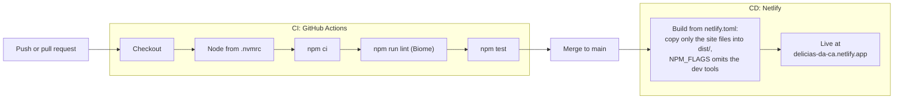

# Cardápio online Delícias da Cá — Plano de implementação

> **For agentic workers:** REQUIRED SUB-SKILL: Use superpowers:subagent-driven-development (recommended) or superpowers:executing-plans to implement this plan task-by-task. Steps use checkbox (`- [ ]`) syntax for tracking.

**Goal:** Publicar um site estático de cardápio de bolos caseiros em que cada bolo tem um botão que abre o WhatsApp da Delícias da Cá com a mensagem do pedido já escrita.

**Architecture:** Página única (`index.html`) em HTML, CSS e JavaScript puros, sem build. Os bolos vêm de `data/menu.json`; `js/app.js` busca o JSON e monta os cards com `textContent`. A lógica que não pode quebrar (link do WhatsApp e formatação de preço) fica em `js/whatsapp.js`, um módulo ES de funções puras, testado com o executor nativo do Node (`node --test`). Na publicação, o Netlify roda o comando do `netlify.toml`, que copia só os arquivos do site para `dist/` e publica essa pasta: o resto do repositório (`docs/`, `tests/`, `scripts/` etc.) não vai ao ar. A qualidade do código é conferida pelo Biome (lint, formatação e ordem dos imports) e, a cada push na `main` e a cada pull request, pelo GitHub Actions, que roda `npm run lint` e `npm test`; o deploy continua sendo só do Netlify (Task 10).

**Tech Stack:** HTML5, CSS3, JavaScript (módulos ES), Node 22 (`node:test`; o `npm test` não precisa instalar nada), `python3 -m http.server` para ver o site localmente, `sips` (macOS) e `cwebp` (Homebrew `webp`), usados pelo `scripts/prepare-photos.mjs` para converter fotos, e Netlify (plano gratuito) para publicar, com um `netlify.toml` que copia só os arquivos do site para `dist/` e que usa `NPM_FLAGS = "--omit=dev"` para o Netlify não instalar o Biome. Na Task 10 entram o Biome 2.6.4 (o único `devDependency`, em versão exata), o GitHub Actions (CI) e o Dependabot.

**Spec:** `docs/superpowers/specs/2026-10-29-cardapio-online-design.md`

---

## Convenções de código

- Todo o código fica em inglês: identificadores (variáveis, funções e constantes), comentários, descrições e mensagens dos testes, nomes de arquivo, chaves do JSON, ids do HTML, classes e propriedades personalizadas do CSS e mensagens de console.
- Só fica em português o que o usuário final vê: os textos, títulos e rótulos da página, a mensagem do WhatsApp, os atributos `alt` e `aria-label`, o `<title>`, a meta description e as tags Open Graph, os avisos e o `name` de cada bolo.
- Exceção deliberada: os valores de `id` dos bolos (por exemplo, `cenoura-vulcao`) e os nomes das fotos derivados deles (`cenoura-vulcao.webp`) seguem o nome do produto, em português. O mesmo vale para `lang="pt-BR"` e `Intl.NumberFormat('pt-BR', ...)`.
- A documentação (spec e plano) continua em português, exceto o `README.md`, que é escrito em inglês por ser a página do projeto no GitHub. Em todos os documentos, todo identificador, caminho, classe ou chave citado usa os nomes em inglês.

## Estrutura de arquivos

| Arquivo | Responsabilidade |
|---|---|
| `package.json` | `name`, `private`, `type` e o script `test`; a Task 10 acrescenta os scripts `lint` e `lint:fix` e o Biome como único `devDependency` (versão exata). Sem dependências de execução. |
| `package-lock.json` | (Task 10) Gerado pelo `npm` e versionado: o CI instala com `npm ci`, que instala exatamente o que o arquivo lista (inclusive os binários do Biome para Linux). |
| `.nvmrc` | (Task 10) `22`: a versão do Node, lida pelo `nvm use` e pelo CI. |
| `biome.json` | (Task 10) Configuração do Biome: aspas simples, ponto e vírgula, 2 espaços, vírgula final, 120 colunas, regras `recommended`, escopo (`js`, `scripts`, `tests`, `css`, `data`, `package.json`, `biome.json`) e o formatador desligado só para `data/menu.json` (um bolo por linha). |
| `.github/workflows/ci.yml` | (Task 10) O CI: em todo push na `main` e em todo pull request, `npm ci`, `npm run lint` e `npm test`, com o Node de `.nvmrc`. Permissão só de leitura, sem segredos, sem deploy. |
| `.github/dependabot.yml` | (Task 10) PRs semanais para as versões das actions e do Biome. |
| `tests/tooling.test.js` | (Task 10) Guarda o contrato entre `.nvmrc`, `package.json`, `ci.yml`, `biome.json` e `netlify.toml`. |
| `.gitignore` | Ignora `.superpowers/`, os prints de referência, `.DS_Store`, `node_modules/`, `fotos-originais/` (as fotos enviadas, antes da otimização) e `dist/` (a pasta que o build do Netlify gera). |
| `js/whatsapp.js` | Funções puras: formatar preço, montar mensagem e link do WhatsApp. Sem DOM. |
| `data/menu.json` | Os 18 bolos, na ordem de exibição. Só dados. |
| `index.html` | Estrutura da página, textos fixos, meta tags (inclusive as de prévia do link, `og:*`), botão geral e aviso de erro. |
| `css/style.css` | Estilo A (rústico artesanal), mobile first. |
| `favicon.svg` | Ícone da aba do navegador: um bolo de forma (com furo no meio e cobertura escorrendo) desenhado em SVG (sem arquivos externos). |
| `js/app.js` | Busca o JSON, monta os cards, trata erro. Usa o DOM. |
| `tests/whatsapp.test.js` | Testa `js/whatsapp.js`. |
| `tests/menu.test.js` | Valida `data/menu.json`. |
| `tests/index.test.js` | Garante que os links e meta tags do `index.html` estão corretos e que a prévia do link (`og:url`, `og:image`, medidas e texto alternativo) aponta para uma imagem real, JPEG ou PNG, de até 300 KB e com as medidas declaradas. |
| `tests/app.test.js` | Garante que `js/app.js` não injeta HTML e usa `rel` seguro. |
| `tests/photos.test.js` | (Task 8) Garante que cada foto presente em `img/` é citada no `data/menu.json` (ou é `hero.webp`) e passa no `checkWebp` de `scripts/photo-lib.mjs` (WebP íntegro, até 200 KB, sem EXIF nem XMP). Lista os bolos ainda sem foto, sem falhar. |
| `scripts/photo-lib.mjs` | (Task 8) Funções puras do conversor de fotos: decidir se precisa reduzir (nunca amplia), ler BMP, achar tarjas pretas, casar o nome do arquivo com o `id` e validar o WebP. Sem efeitos colaterais. |
| `scripts/prepare-photos.mjs` | (Task 8) O comando `node scripts/prepare-photos.mjs`: converte as fotos de `fotos-originais/` em `img/<id>.webp`. Usa `sips` (macOS) e `cwebp`. |
| `tests/photo-lib.test.js` | (Task 8) Testa `scripts/photo-lib.mjs`. |
| `tests/prepare-photos.test.js` | (Task 8) Testa o comando de ponta a ponta com imagens sintéticas. É pulado quando faltam `sips` ou `cwebp`. |
| `img/` | Fotos otimizadas (Task 8), que podem chegar em lotes. |
| `README.md` | Página do projeto no GitHub, em inglês: o que é, como rodar, editar o cardápio, converter fotos, testar e publicar no Netlify. |
| `og-image.jpg` | (Task 9) Imagem da prévia do link no WhatsApp e no Instagram: JPEG de 1200x630, menos de 300 KB, recortada de `img/hero.webp`. Binário: o plano descreve como gerar. |
| `netlify.toml` | (Task 9) Diz ao Netlify o que publicar: o comando de build copia só os arquivos do site (`index.html`, `favicon.svg`, `og-image.jpg`, `css`, `js`, `data` e `img`) para `dist/`, e `dist` é a pasta publicada. A Task 10 acrescenta `NPM_FLAGS = "--omit=dev"`, para o Netlify não instalar o Biome. |
| `tests/netlify.test.js` | (Task 9) Confere o `netlify.toml`: o `publish` e o destino do `cp -R` são o mesmo, os caminhos existem, tudo o que a página usa está na lista, nenhuma pasta interna (`docs`, `tests`, `scripts`...) entra, e o comando de build, rodado numa cópia temporária, gera o `dist/` esperado. |

## Regras gerais deste plano

- Rodar os testes: `npm test` (equivale a `node --test tests/*.test.js`).
- A página não tem dependência de execução, e o `npm test` não precisa de instalação. Até a Task 9 não há nada para instalar (não rodar `npm install`); a Task 10 acrescenta o Biome como único `devDependency`, e daí em diante o `npm ci` só é necessário para o lint e a formatação.
- Se o sandbox do Apple Claude Code bloquear a abertura de porta (`EPERM on listen`) na Task 7, **não** altere allowlists nem o sandbox. Peça ao usuário para rodar `python3 -m http.server 8000` num terminal dele.
- Os dois prints na raiz (`Screenshot ...png`) são do usuário. Não apague nem mova sem pedir.

---

### Task 1: Branch e estrutura básica

**Files:**
- Create: `.gitignore`
- Create: `package.json`
- Add (já existem): `docs/superpowers/specs/2026-10-29-cardapio-online-design.md`, `docs/superpowers/plans/2026-10-29-cardapio-online.md`

- [ ] **Step 1: Criar a branch de trabalho**

Run: `git switch -c feat/cardapio-online`
Expected: `Switched to a new branch 'feat/cardapio-online'`

- [ ] **Step 2: Criar `.gitignore`**

```gitignore
.superpowers/
Screenshot *.png
.DS_Store
node_modules/
fotos-originais/
dist/
```

A linha `dist/` é da pasta que o build do Netlify gera na Task 9: ela nunca vai para o Git.

- [ ] **Step 3: Criar `package.json`**

```json
{
  "name": "delicias-da-ca",
  "private": true,
  "type": "module",
  "scripts": {
    "test": "node --test tests/*.test.js"
  }
}
```

- [ ] **Step 4: Conferir que os prints saíram do `git status`**

Run: `git status --short`
Expected: aparecem `.gitignore`, `package.json` e `docs/`. **Não** aparecem `Screenshot ...png` nem `.superpowers/`.

- [ ] **Step 5: Commit**

```bash
git add .gitignore package.json docs/
git commit -m "chore: estrutura inicial, spec e plano do cardápio online"
```

---

### Task 2: Link do WhatsApp e preço (`js/whatsapp.js`)

**Files:**
- Create: `tests/whatsapp.test.js`
- Create: `js/whatsapp.js`

- [ ] **Step 1: Escrever os testes que falham**

Criar `tests/whatsapp.test.js`:

```js
import assert from 'node:assert/strict';
import { test } from 'node:test';
import {
  cakeLink,
  cakeMessage,
  formatPrice,
  GENERAL_LINK,
  GENERAL_MESSAGE,
  WHATSAPP_NUMBER,
  whatsappLink,
} from '../js/whatsapp.js';

test('formatPrice shows reais with a comma and two decimals', () => {
  assert.equal(formatPrice(50), 'R$ 50,00');
  assert.equal(formatPrice(30), 'R$ 30,00');
  assert.equal(formatPrice(32.5), 'R$ 32,50');
});

test('formatPrice has no whitespace other than a plain space', () => {
  assert.ok(!/[^\S ]/.test(formatPrice(50)));
});

test('cakeMessage mentions the cake name and price', () => {
  const message = cakeMessage({ name: 'Cenoura vulcão', price: 50 });
  assert.equal(message, 'Olá, Cá! Vim pelo cardápio online e quero encomendar o bolo de Cenoura vulcão (R$ 50,00).');
});

test('whatsappLink points to the number with country code and area code', () => {
  assert.equal(WHATSAPP_NUMBER, '5519996851415');
  const url = new URL(whatsappLink('oi'));
  assert.equal(url.origin, 'https://wa.me');
  assert.equal(url.pathname, '/5519996851415');
});

test('whatsappLink encodes accents, spaces and symbols without losing anything', () => {
  const message = 'A&B #1 100% +extra 😀 (R$ 50,00)? Paçoca vulcão';
  const link = whatsappLink(message);
  assert.ok(!/\s/.test(link), 'the link must not contain whitespace');
  assert.ok(!link.includes('+'));
  assert.equal(new URL(link).searchParams.get('text'), message);
});

test('cakeLink opens WhatsApp with the message for that cake', () => {
  const cake = { name: 'Paçoca vulcão', price: 50 };
  const url = new URL(cakeLink(cake));
  assert.equal(url.searchParams.get('text'), cakeMessage(cake));
});

test('GENERAL_LINK uses the general message, without a cake name', () => {
  assert.equal(GENERAL_MESSAGE, 'Olá, Cá! Vim pelo cardápio online e gostaria de fazer uma encomenda.');
  assert.equal(new URL(GENERAL_LINK).searchParams.get('text'), GENERAL_MESSAGE);
});
```

- [ ] **Step 2: Rodar e ver falhar**

Run: `npm test`
Expected: FAIL com `ERR_MODULE_NOT_FOUND` apontando para `js/whatsapp.js`.

- [ ] **Step 3: Implementar**

Criar `js/whatsapp.js`:

```js
export const WHATSAPP_NUMBER = '5519996851415';

export const GENERAL_MESSAGE = 'Olá, Cá! Vim pelo cardápio online e gostaria de fazer uma encomenda.';

const brlFormatter = new Intl.NumberFormat('pt-BR', {
  style: 'currency',
  currency: 'BRL',
});

// Intl separates "R$" from the number with a no-break space (U+00A0), and
// other ICU versions may use U+202F. Normalize every whitespace character to
// a plain space so the text reads the same on screen and in WhatsApp.
export function formatPrice(value) {
  return brlFormatter.format(value).replace(/\s/g, ' ');
}

export function cakeMessage(cake) {
  return `Olá, Cá! Vim pelo cardápio online e quero encomendar o bolo de ${cake.name} (${formatPrice(cake.price)}).`;
}

export function whatsappLink(message) {
  return `https://wa.me/${WHATSAPP_NUMBER}?text=${encodeURIComponent(message)}`;
}

export function cakeLink(cake) {
  return whatsappLink(cakeMessage(cake));
}

export const GENERAL_LINK = whatsappLink(GENERAL_MESSAGE);
```

- [ ] **Step 4: Rodar e ver passar**

Run: `npm test`
Expected: `ℹ pass 7` e `ℹ fail 0`.

- [ ] **Step 5: Commit**

```bash
git add js/whatsapp.js tests/whatsapp.test.js
git commit -m "feat: link do WhatsApp e formatação de preço"
```

---

### Task 3: Dados do cardápio (`data/menu.json`)

**Files:**
- Create: `tests/menu.test.js`
- Create: `data/menu.json`

- [ ] **Step 1: Escrever os testes que falham**

Criar `tests/menu.test.js`:

```js
import assert from 'node:assert/strict';
import { readFile } from 'node:fs/promises';
import { test } from 'node:test';

async function load() {
  const text = await readFile(new URL('../data/menu.json', import.meta.url), 'utf8');
  return JSON.parse(text);
}

test('menu.json is valid JSON containing a list', async () => {
  const cakes = await load();
  assert.ok(Array.isArray(cakes));
});

// Update this number when you add or remove a flavor on purpose.
const EXPECTED_COUNT = 18;

test('menu.json has the expected number of cakes', async () => {
  const cakes = await load();
  assert.equal(
    cakes.length,
    EXPECTED_COUNT,
    `found ${cakes.length} cakes, expected ${EXPECTED_COUNT}. If you added or removed a flavor on purpose, update EXPECTED_COUNT in tests/menu.test.js`,
  );
});

test('every cake has a valid id, name, price and photo named after its id', async () => {
  const cakes = await load();
  for (const cake of cakes) {
    assert.match(cake.id, /^[a-z0-9]+(-[a-z0-9]+)*$/, `invalid id: ${cake.id}`);
    assert.equal(typeof cake.name, 'string', `invalid name in ${cake.id}`);
    assert.ok(cake.name.trim().length > 0, `empty name in ${cake.id}`);
    assert.equal(typeof cake.price, 'number', `invalid price in ${cake.id}`);
    assert.ok(Number.isFinite(cake.price) && cake.price > 0, `price must be > 0 in ${cake.id}`);
    assert.equal(cake.photo, `${cake.id}.webp`, `photo must be ${cake.id}.webp in ${cake.id}`);
  }
});

test('ids are unique', async () => {
  const cakes = await load();
  const ids = cakes.map((cake) => cake.id);
  const duplicates = ids.filter((id, index) => ids.indexOf(id) !== index);
  assert.deepEqual(duplicates, [], `duplicate ids: ${duplicates.join(', ')}`);
});
```

- [ ] **Step 2: Rodar e ver falhar**

Run: `npm test`
Expected: os testes de `menu.test.js` falham com `ENOENT` para `data/menu.json`. Os de `whatsapp.test.js` continuam passando.

- [ ] **Step 3: Criar o JSON**

Criar `data/menu.json` (preços do cardápio atual, na mesma ordem dele):

```json
[
  { "id": "banana", "name": "Banana", "price": 35, "photo": "banana.webp" },
  { "id": "cenoura", "name": "Cenoura", "price": 30, "photo": "cenoura.webp" },
  { "id": "cenoura-brigadeiro", "name": "Cenoura com cobertura de brigadeiro", "price": 40, "photo": "cenoura-brigadeiro.webp" },
  { "id": "cenoura-chocolate", "name": "Cenoura com cobertura de chocolate", "price": 35, "photo": "cenoura-chocolate.webp" },
  { "id": "cenoura-vulcao", "name": "Cenoura vulcão", "price": 50, "photo": "cenoura-vulcao.webp" },
  { "id": "chocolate", "name": "Chocolate", "price": 30, "photo": "chocolate.webp" },
  { "id": "chocolate-brigadeiro", "name": "Chocolate com cobertura de brigadeiro", "price": 40, "photo": "chocolate-brigadeiro.webp" },
  { "id": "chocolate-chocolate", "name": "Chocolate com cobertura de chocolate", "price": 35, "photo": "chocolate-chocolate.webp" },
  { "id": "fuba", "name": "Fubá", "price": 30, "photo": "fuba.webp" },
  { "id": "fuba-goiabada", "name": "Fubá com goiabada", "price": 35, "photo": "fuba-goiabada.webp" },
  { "id": "fuba-cremoso", "name": "Fubá cremoso", "price": 40, "photo": "fuba-cremoso.webp" },
  { "id": "laranja", "name": "Laranja", "price": 30, "photo": "laranja.webp" },
  { "id": "limao", "name": "Limão", "price": 40, "photo": "limao.webp" },
  { "id": "milho", "name": "Milho", "price": 35, "photo": "milho.webp" },
  { "id": "ninho-cobertura", "name": "Ninho com cobertura", "price": 40, "photo": "ninho-cobertura.webp" },
  { "id": "ninho-vulcao", "name": "Ninho vulcão", "price": 50, "photo": "ninho-vulcao.webp" },
  { "id": "pacoca", "name": "Paçoca", "price": 40, "photo": "pacoca.webp" },
  { "id": "pacoca-vulcao", "name": "Paçoca vulcão", "price": 50, "photo": "pacoca-vulcao.webp" }
]
```

- [ ] **Step 4: Rodar e ver passar**

Run: `npm test`
Expected: `ℹ fail 0`.

- [ ] **Step 5: Conferir nomes e preços contra o cardápio original**

Abrir a imagem do cardápio (o print `Screenshot 2026-10-29 at 16.20.55.png`) ao lado de `data/menu.json` e conferir, linha a linha, nome e preço dos 18 sabores. Os testes não pegam um preço digitado errado. Se algo estiver diferente, corrigir o JSON e rodar `npm test` de novo.

- [ ] **Step 6: Commit**

```bash
git add data/menu.json tests/menu.test.js
git commit -m "feat: dados dos 18 bolos do cardápio"
```

---

### Task 4: Estrutura da página (`index.html`)

**Files:**
- Create: `tests/index.test.js`
- Create: `index.html`
- Create: `favicon.svg`

- [ ] **Step 1: Escrever os testes que falham**

Criar `tests/index.test.js`:

```js
import assert from 'node:assert/strict';
import { access, readFile } from 'node:fs/promises';
import { test } from 'node:test';
import { GENERAL_LINK } from '../js/whatsapp.js';

const html = await readFile(new URL('../index.html', import.meta.url), 'utf8');

// hero button, error notice, noscript fallback and footer
const EXPECTED_WHATSAPP_LINK_COUNT = 4;

test('every WhatsApp link in index.html is the general link', () => {
  const links = [...html.matchAll(/href="(https:\/\/wa\.me\/[^"]*)"/g)].map((m) => m[1]);
  assert.equal(
    links.length,
    EXPECTED_WHATSAPP_LINK_COUNT,
    `expected ${EXPECTED_WHATSAPP_LINK_COUNT} WhatsApp links (hero, error notice, noscript, footer), found ${links.length}. If you added or removed one on purpose, update EXPECTED_WHATSAPP_LINK_COUNT in tests/index.test.js`,
  );
  for (const link of links) {
    assert.equal(link, GENERAL_LINK);
  }
});

test('links that open in a new tab use a safe rel', () => {
  const anchors = [...html.matchAll(/<a\b[^>]*>/gi)].map((m) => m[0]);
  const opened = anchors.filter((tag) => /target\s*=\s*["']?_blank/i.test(tag));
  assert.ok(opened.length > 0);
  for (const tag of opened) {
    const rel = /rel\s*=\s*["']([^"']*)["']/i.exec(tag)?.[1] ?? '';
    const tokens = rel.split(/\s+/);
    assert.ok(
      tokens.includes('noopener') && tokens.includes('noreferrer'),
      `missing rel="noopener noreferrer" in: ${tag}`,
    );
  }
});

test('index.html has a title, description and preview tags', () => {
  assert.match(html, /<title>[^<]+<\/title>/);
  assert.match(html, /<meta name="description" content="[^"]+">/);
  assert.match(html, /<meta property="og:title" content="[^"]+">/);
  assert.match(html, /<meta property="og:description" content="[^"]+">/);
});

test('index.html has the menu mount point and the error notice', () => {
  assert.match(html, /id="menu-list"/);
  assert.match(html, /id="menu-notice"/);
});

test('the error notice is hidden by default and the noscript fallback offers WhatsApp', () => {
  // js/app.js reveals the notice with `notice.hidden = false` when the menu fails to load.
  assert.match(html, /<div id="menu-notice"[^>]*\bhidden\b/);
  assert.match(html, /<noscript>[\s\S]*https:\/\/wa\.me\/[\s\S]*<\/noscript>/);
});

test('index.html links a favicon that exists', async () => {
  const href = /<link rel="icon" href="([^"]+)"/.exec(html)?.[1];
  assert.ok(href, 'expected a <link rel="icon" href="..."> in index.html');
  await access(new URL(`../${href}`, import.meta.url));
});

// WhatsApp and Instagram fetch the preview image by its absolute URL, so the
// tests check that URL, the file behind it and the size declared in the tags.
const PREVIEW_IMAGE_MAX_BYTES = 300 * 1024;
const JPEG_MAGIC = [0xff, 0xd8, 0xff];
const PNG_MAGIC = [0x89, 0x50, 0x4e, 0x47, 0x0d, 0x0a, 0x1a, 0x0a];

function metaContent(property) {
  return new RegExp(`<meta property="${property}" content="([^"]*)">`).exec(html)?.[1];
}

function startsWith(bytes, magic) {
  return magic.every((byte, i) => bytes[i] === byte);
}

// Width and height without any dependency. A PNG keeps them in the first chunk
// (IHDR, bytes 16 to 23). A JPEG is a chain of marker segments; the Start Of
// Frame segment (SOF0 baseline, SOF1 or SOF2 progressive) has them after the
// marker (2 bytes), the length (2) and the precision (1).
function readImageSize(bytes) {
  if (startsWith(bytes, PNG_MAGIC)) {
    return { width: bytes.readUInt32BE(16), height: bytes.readUInt32BE(20) };
  }
  let offset = 2; // skip the start-of-image marker (FF D8)
  while (offset + 4 <= bytes.length && bytes[offset] === 0xff) {
    const marker = bytes[offset + 1];
    if (marker === 0xc0 || marker === 0xc1 || marker === 0xc2) {
      return { height: bytes.readUInt16BE(offset + 5), width: bytes.readUInt16BE(offset + 7) };
    }
    offset += 2 + bytes.readUInt16BE(offset + 2);
  }
  return null;
}

async function loadPreviewImage() {
  const image = metaContent('og:image');
  assert.ok(image, 'expected <meta property="og:image" content="..."> in index.html');
  const bytes = await readFile(new URL(`..${new URL(image).pathname}`, import.meta.url));
  return { image, bytes };
}

test('og:url is an absolute https URL that ends with a slash', () => {
  const pageUrl = metaContent('og:url');
  assert.ok(pageUrl, 'expected <meta property="og:url" content="..."> in index.html');
  assert.equal(new URL(pageUrl).protocol, 'https:');
  assert.ok(pageUrl.endsWith('/'), `og:url should end with "/", got ${pageUrl}`);
});

test('og:image is absolute, on the same origin as og:url, and points to a file in the repo', async () => {
  const pageUrl = metaContent('og:url');
  const image = metaContent('og:image');
  assert.ok(pageUrl && image, 'expected og:url and og:image in index.html');
  assert.match(image, /^https:\/\//, `og:image should be an absolute https URL, got ${image}`);
  assert.equal(new URL(image).origin, new URL(pageUrl).origin, 'og:image and og:url are on different origins');
  await loadPreviewImage(); // throws if the file is missing at the repo root
});

test('the preview image is a JPEG or PNG of at most 300 KB', async () => {
  const { image, bytes } = await loadPreviewImage();
  assert.ok(
    startsWith(bytes, JPEG_MAGIC) || startsWith(bytes, PNG_MAGIC),
    `${image} is not a JPEG or PNG (WhatsApp may ignore other formats, such as WebP)`,
  );
  assert.ok(
    bytes.length <= PREVIEW_IMAGE_MAX_BYTES,
    `${image} has ${bytes.length} bytes; WhatsApp may drop images above ${PREVIEW_IMAGE_MAX_BYTES}`,
  );
});

test('og:image:width and og:image:height are the real size of the preview image', async () => {
  const { bytes } = await loadPreviewImage();
  const width = metaContent('og:image:width');
  const height = metaContent('og:image:height');
  assert.match(width ?? '', /^\d+$/, `og:image:width should be a number, got ${width}`);
  assert.match(height ?? '', /^\d+$/, `og:image:height should be a number, got ${height}`);
  assert.deepEqual({ width: Number(width), height: Number(height) }, readImageSize(bytes));
});

test('og:image:alt is not empty', () => {
  assert.match(metaContent('og:image:alt') ?? '', /\S/);
});
```

- [ ] **Step 2: Rodar e ver falhar**

Run: `npm test`
Expected: `tests/index.test.js` falha com `ENOENT` para `index.html`.

- [ ] **Step 3: Criar `index.html` e `favicon.svg`**

O endereço do WhatsApp aparece como `https://wa.me/5519996851415?text=Ol%C3%A1%2C%20C%C3%A1!%20Vim%20pelo%20card%C3%A1pio%20online%20e%20gostaria%20de%20fazer%20uma%20encomenda.` em quatro lugares. Ele precisa ser idêntico ao `GENERAL_LINK` (o teste confere). O link está escrito direto no HTML porque o botão do topo precisa funcionar mesmo sem JavaScript.

As tags de prévia do link (`og:url`, `og:image`, `og:image:width`, `og:image:height` e `og:image:alt`) já entram aqui com o endereço final do site, `https://delicias-da-ca.netlify.app/`. O `og:image` aponta para o `og-image.jpg`, um JPEG de 1200x630 recortado do `img/hero.webp`, que a Task 9 (Step 1) ensina a gerar.

```html
<!DOCTYPE html>
<html lang="pt-BR">
<head>
  <meta charset="utf-8">
  <meta name="viewport" content="width=device-width, initial-scale=1">
  <title>Delícias da Cá · Bolos caseiros em Campinas</title>
  <meta name="description" content="Bolos caseiros em Campinas/SP, com entrega. Veja o cardápio e faça sua encomenda pelo WhatsApp.">
  <meta name="theme-color" content="#4a2c1a">
  <meta property="og:type" content="website">
  <meta property="og:locale" content="pt_BR">
  <meta property="og:title" content="Delícias da Cá · Bolos caseiros em Campinas">
  <meta property="og:description" content="Bolos caseiros com entrega em Campinas/SP. Veja o cardápio e peça pelo WhatsApp.">
  <meta property="og:url" content="https://delicias-da-ca.netlify.app/">
  <meta property="og:image" content="https://delicias-da-ca.netlify.app/og-image.jpg">
  <meta property="og:image:width" content="1200">
  <meta property="og:image:height" content="630">
  <meta property="og:image:alt" content="Cinco bolos caseiros da Delícias da Cá enfileirados sobre a bancada">
  <link rel="icon" href="favicon.svg" type="image/svg+xml">
  <link rel="stylesheet" href="css/style.css">
  <script type="module" src="js/app.js"></script>
</head>
<body>
  <header class="hero">
    <div class="container">
      <h1 class="hero__brand">Delícias da Cá</h1>
      <p class="hero__tagline">Bolos caseiros, feitos com carinho</p>
      <div class="hero__photo">
        
      </div>
      <a class="button button--large" href="https://wa.me/5519996851415?text=Ol%C3%A1%2C%20C%C3%A1!%20Vim%20pelo%20card%C3%A1pio%20online%20e%20gostaria%20de%20fazer%20uma%20encomenda." target="_blank" rel="noopener noreferrer">Fazer encomenda no WhatsApp</a>
    </div>
  </header>

  <main>
    <section class="notices" aria-label="Entrega e horários">
      <div class="container">
        <p><strong>Entregamos em Campinas.</strong> A taxa é combinada pelo WhatsApp.</p>
        <p><strong>Segunda a quarta:</strong> encomendas somente no período da manhã.</p>
        <p><strong>Quinta a domingo:</strong> pronta entrega, encomendas e entregas o dia todo.</p>
      </div>
    </section>

    <section class="menu" aria-labelledby="menu-title">
      <div class="container">
        <h2 id="menu-title" class="section-title">Cardápio</h2>
        <ul id="menu-list" class="menu__list" role="list"></ul>
        <div id="menu-notice" class="error-notice" hidden>
          <p>Não conseguimos mostrar o cardápio agora. Chame a Cá no WhatsApp e ela te passa os sabores e os preços.</p>
          <a class="button" href="https://wa.me/5519996851415?text=Ol%C3%A1%2C%20C%C3%A1!%20Vim%20pelo%20card%C3%A1pio%20online%20e%20gostaria%20de%20fazer%20uma%20encomenda." target="_blank" rel="noopener noreferrer">Falar com a Cá no WhatsApp</a>
        </div>
        <noscript>
          <div class="error-notice">
            <p>Para ver o cardápio, ative o JavaScript do navegador. Ou chame a Cá no WhatsApp e ela te passa os sabores e os preços.</p>
            <a class="button" href="https://wa.me/5519996851415?text=Ol%C3%A1%2C%20C%C3%A1!%20Vim%20pelo%20card%C3%A1pio%20online%20e%20gostaria%20de%20fazer%20uma%20encomenda." target="_blank" rel="noopener noreferrer">Falar com a Cá no WhatsApp</a>
          </div>
        </noscript>
      </div>
    </section>

    <section class="how-to-order" aria-labelledby="how-to-order-title">
      <div class="container">
        <h2 id="how-to-order-title" class="section-title">Como pedir</h2>
        <ol>
          <li>Escolha o seu bolo.</li>
          <li>Toque em “Pedir pelo WhatsApp”.</li>
          <li>Combine data, horário e entrega com a Cá.</li>
        </ol>
      </div>
    </section>
  </main>

  <footer class="site-footer">
    <div class="container">
      <p>Delícias da Cá · Campinas/SP</p>
      <p>WhatsApp: <a href="https://wa.me/5519996851415?text=Ol%C3%A1%2C%20C%C3%A1!%20Vim%20pelo%20card%C3%A1pio%20online%20e%20gostaria%20de%20fazer%20uma%20encomenda." target="_blank" rel="noopener noreferrer">(19) 99685-1415</a></p>
    </div>
  </footer>
</body>
</html>
```

Criar `favicon.svg` (um bolo de forma com cobertura escorrendo, sobre um pratinho, desenhado em SVG, sem arquivos externos nem licença a respeitar; o teste do `<link rel="icon">` confere que o arquivo existe):

```svg
<svg xmlns="http://www.w3.org/2000/svg" viewBox="0 0 64 64">
  <!-- Homemade ring cake ("bolo de forma") with dripping glaze on a plate -->
  <g stroke="#4a2c1a" stroke-width="2.2" stroke-linejoin="round" stroke-linecap="round">
    <!-- plate and its rim -->
    <ellipse cx="32" cy="50" rx="30" ry="9" fill="#f4f1ea"/>
    <ellipse cx="32" cy="49" rx="24" ry="6" fill="none" stroke="#d6cab8" stroke-width="1.5"/>
    <!-- cake body, darker crust at the base, outline -->
    <path d="M8 21 L9 44 C9 53 55 53 55 44 L56 21 Z" fill="#d9a35f" stroke="none"/>
    <path d="M9 44 C9 53 55 53 55 44 C55 48.5 9 48.5 9 44 Z" fill="#a8683a" stroke="none"/>
    <path d="M8 21 L9 44 C9 53 55 53 55 44 L56 21" fill="none"/>
    <!-- glaze over the top, dripping down the front -->
    <path d="M7.5 21 C7.5 5 56.5 5 56.5 21 L56.5 25 Q55.5 28 53 29.5 L53 36 C53 40 47.5 40 47.5 36 L47.5 31.6 Q43.5 32.8 40 33.2 L40 42 C40 46 34 46 34 42 L34 33.6 Q29 33.6 25.5 33.2 L25.5 38.5 C25.5 42.5 20 42.5 20 38.5 L20 32.4 Q16.5 31.5 14.5 30.6 L14.5 34 C14.5 37.5 9.5 37.5 9.5 34 L9.5 28.5 Q7.7 27 7.5 25 Z" fill="#fff3dc"/>
    <!-- centre hole: inner crumb wall and dark opening -->
    <ellipse cx="32" cy="17" rx="9" ry="3.8" fill="#a8683a"/>
    <ellipse cx="32" cy="18.3" rx="7" ry="2.5" fill="#4a2c1a" stroke="none"/>
    <!-- glaze shine -->
    <path d="M14.5 18 Q16.5 13.5 21.5 11.8" fill="none" stroke="#fff" stroke-width="2"/>
  </g>
  <!-- lime zest -->
  <g fill="#7fb236">
    <circle cx="19" cy="22" r="1.1"/><circle cx="44" cy="23.5" r="1.1"/><circle cx="39" cy="12.3" r="1.1"/><circle cx="27" cy="25.5" r="1.1"/><circle cx="50" cy="16.5" r="1.1"/>
  </g>
</svg>
```

- [ ] **Step 4: Rodar e ver passar**

Run: `npm test`
Expected: `ℹ fail 0`, se o `og-image.jpg` já existir (com o `img/hero.webp` no repositório, gere-o agora, pelo Step 1 da Task 9, e inclua-o no commit abaixo). Sem ele, falham só os 3 testes da imagem de prévia (`og:image is absolute, on the same origin as og:url, and points to a file in the repo`, `the preview image is a JPEG or PNG of at most 300 KB` e `og:image:width and og:image:height are the real size of the preview image`), e eles passam no Step 1 da Task 9. Se o primeiro teste de `index.test.js` falhar, o link colado no HTML difere do `GENERAL_LINK`: rode `node -e "import('./js/whatsapp.js').then(m => console.log(m.GENERAL_LINK))"` e copie a saída exatamente.

- [ ] **Step 5: Commit**

```bash
git add index.html favicon.svg tests/index.test.js
git commit -m "feat: estrutura da página com topo, avisos, cardápio e rodapé"
```

---

### Task 5: Estilo A, rústico artesanal (`css/style.css`)

**Files:**
- Create: `css/style.css`

CSS não tem teste automatizado. A conferência visual é a Task 7.

- [ ] **Step 1: Criar `css/style.css`**

O verde do botão é `#3f6f2a` (cerca de 6:1 com texto branco), mais escuro que o do mockup, para passar dos 4,5:1 de contraste.

```css
:root {
  --cream: #f4e9d3;
  --cream-dark: #efdfc0;
  --paper: #fffaf0;
  --brown: #4a2c1a;
  --brown-light: #7a4a22;
  --border: #b48a5a;
  --green: #3f6f2a;
  --green-dark: #2f5520;
  --empty-photo: linear-gradient(135deg, #d9a35f, #a8683a);
  --font-script: 'Segoe Script', 'Brush Script MT', 'Snell Roundhand', cursive;
  --font-body: Georgia, 'Times New Roman', serif;
  --font-button: system-ui, -apple-system, 'Segoe UI', Roboto, sans-serif;
}

* {
  box-sizing: border-box;
}

body {
  margin: 0;
  background: var(--cream);
  color: var(--brown);
  font-family: var(--font-body);
  font-size: 1rem;
  line-height: 1.5;
}

.container {
  max-width: 1000px;
  margin: 0 auto;
  padding: 0 1rem;
}

/* WhatsApp button (used in the hero, in the cards and in the notices) */
.button {
  display: inline-flex;
  align-items: center;
  justify-content: center;
  min-height: 44px;
  padding: 0.5rem 1rem;
  background: var(--green);
  color: #fff;
  font-family: var(--font-button);
  font-size: 0.95rem;
  font-weight: 700;
  line-height: 1.2;
  text-align: center;
  text-decoration: none;
  border-radius: 4px;
  /* Keeps the button shape visible in forced-colors (high-contrast) mode. */
  border: 2px solid transparent;
}

.button:hover {
  background: var(--green-dark);
}

.button:focus-visible,
.site-footer a:focus-visible {
  outline: 3px solid var(--brown);
  outline-offset: 2px;
}

.button--large {
  font-size: 1.05rem;
  padding: 0.65rem 1.25rem;
}

/* Hero */
.hero {
  background: var(--cream-dark);
  border-bottom: 3px double var(--border);
  padding: 1.25rem 0 1.5rem;
  text-align: center;
}

.hero__brand {
  margin: 0;
  font-family: var(--font-script);
  font-size: 2.75rem;
  font-weight: 400;
  line-height: 1.15;
}

.hero__tagline {
  margin: 0.25rem 0 1rem;
}

.hero__photo {
  max-width: 560px;
  aspect-ratio: 4 / 3;
  margin: 0 auto 1rem;
  background: var(--empty-photo);
  border-radius: 8px;
  overflow: hidden;
}

.hero__photo img {
  display: block;
  width: 100%;
  height: 100%;
  object-fit: cover;
}

/* Delivery and opening-hours notices */
.notices {
  padding: 1rem 0;
  border-bottom: 1px dashed var(--border);
}

.notices p {
  margin: 0.35rem 0;
}

/* Section titles */
.section-title {
  margin: 0 0 1rem;
  padding-bottom: 0.5rem;
  border-bottom: 2px solid var(--border);
  font-size: 1.35rem;
  text-align: center;
}

.menu,
.how-to-order {
  padding: 1.5rem 0;
}

/* Menu */
.menu__list {
  display: grid;
  grid-template-columns: minmax(0, 1fr);
  gap: 0.75rem;
  margin: 0;
  padding: 0;
  list-style: none;
}

.cake {
  display: flex;
  flex-wrap: wrap;
  align-items: center;
  gap: 0.75rem;
  padding: 0.5rem;
  background: var(--paper);
  border: 2px solid var(--border);
  border-radius: 6px;
}

.cake__photo {
  flex: none;
  width: 112px;
  height: 112px;
  background: var(--empty-photo);
  border-radius: 4px;
  overflow: hidden;
}

.cake__photo img {
  display: block;
  width: 100%;
  height: 100%;
  object-fit: cover;
}

.cake__details {
  flex: 1 1 8rem;
  min-width: 0;
}

.cake__name {
  margin: 0;
  font-size: 1.05rem;
  line-height: 1.25;
  overflow-wrap: anywhere;
}

.cake__price {
  margin: 0.15rem 0 0.5rem;
  color: var(--brown-light);
  font-weight: 700;
  white-space: nowrap;
}

/* Notice shown when the menu fails to load.
   Do not set `display` here: it would override the `hidden` attribute
   that js/app.js removes when the menu fails to load. */
.error-notice {
  padding: 1rem;
  background: var(--paper);
  border: 2px solid var(--border);
  border-radius: 6px;
  text-align: center;
}

.error-notice p {
  margin: 0 0 1rem;
}

/* How to order */
.how-to-order ol {
  max-width: 420px;
  margin: 0 auto;
  padding-left: 1.5rem;
}

.how-to-order li {
  margin: 0.4rem 0;
}

/* Footer */
.site-footer {
  padding: 1.25rem 0;
  background: var(--cream-dark);
  border-top: 3px double var(--border);
  text-align: center;
  font-size: 0.9rem;
}

.site-footer p {
  margin: 0.25rem 0;
}

.site-footer a {
  color: var(--brown);
  font-weight: 700;
}

/* Larger screens: more menu columns */
@media (min-width: 640px) {
  .menu__list {
    grid-template-columns: repeat(2, minmax(0, 1fr));
  }
}

@media (min-width: 960px) {
  .menu__list {
    grid-template-columns: repeat(3, minmax(0, 1fr));
  }
}
```

- [ ] **Step 2: Conferir que os testes continuam verdes**

Run: `npm test`
Expected: `ℹ fail 0`.

- [ ] **Step 3: Commit**

```bash
git add css/style.css
git commit -m "feat: estilo rústico artesanal, mobile first"
```

---

### Task 6: Montagem dos cards (`js/app.js`)

**Files:**
- Create: `tests/app.test.js`
- Create: `js/app.js`

- [ ] **Step 1: Escrever os testes que falham**

Criar `tests/app.test.js`:

```js
import assert from 'node:assert/strict';
import { readFile } from 'node:fs/promises';
import { test } from 'node:test';

const code = await readFile(new URL('../js/app.js', import.meta.url), 'utf8');

test('app.js never injects HTML', () => {
  for (const forbidden of ['innerHTML', 'outerHTML', 'insertAdjacentHTML', 'document.write']) {
    assert.ok(!code.includes(forbidden), `${forbidden} must not appear in app.js`);
  }
});

test('app.js opens WhatsApp links with a safe rel', () => {
  assert.match(code, /\.rel\s*=\s*'noopener noreferrer'/);
});

test('app.js revalidates the menu on every visit', () => {
  assert.match(code, /fetch\(MENU_URL,\s*\{\s*cache:\s*'no-cache'\s*\}\)/);
});

test('app.js sets loading before src so lazy loading is honored', () => {
  assert.ok(code.indexOf("photo.loading = 'lazy'") !== -1);
  assert.ok(code.indexOf("photo.loading = 'lazy'") < code.indexOf('photo.src ='));
});
```

- [ ] **Step 2: Rodar e ver falhar**

Run: `npm test`
Expected: `tests/app.test.js` falha com `ENOENT` para `js/app.js`.

- [ ] **Step 3: Implementar**

Criar `js/app.js`:

```js
import { cakeLink, formatPrice } from './whatsapp.js';

const MENU_URL = 'data/menu.json';
const PHOTOS_DIR = 'img/';

const list = document.getElementById('menu-list');
const notice = document.getElementById('menu-notice');

function createPhoto(cake) {
  const frame = document.createElement('div');
  frame.className = 'cake__photo';

  const photo = document.createElement('img');
  // Without a photo, the brown block of the frame keeps showing.
  photo.addEventListener('error', () => photo.remove());
  // Set loading before src: some browsers ignore it otherwise.
  photo.loading = 'lazy';
  photo.src = PHOTOS_DIR + cake.photo;
  photo.alt = `Bolo de ${cake.name}`;

  frame.append(photo);
  return frame;
}

function createDetails(cake) {
  const details = document.createElement('div');
  details.className = 'cake__details';

  const name = document.createElement('h3');
  name.className = 'cake__name';
  name.textContent = cake.name;

  const price = document.createElement('p');
  price.className = 'cake__price';
  price.textContent = formatPrice(cake.price);

  const button = document.createElement('a');
  button.className = 'button';
  button.href = cakeLink(cake);
  button.target = '_blank';
  button.rel = 'noopener noreferrer';
  button.textContent = 'Pedir pelo WhatsApp';
  button.setAttribute('aria-label', `Pedir pelo WhatsApp: ${cake.name}`);

  details.append(name, price, button);
  return details;
}

function createCard(cake) {
  const card = document.createElement('li');
  card.className = 'cake';
  card.append(createPhoto(cake), createDetails(cake));
  return card;
}

async function init() {
  try {
    // Revalidate on every visit so a price change shows up right after publishing
    // (static hosts can otherwise serve a cached menu.json for several minutes).
    const response = await fetch(MENU_URL, { cache: 'no-cache' });
    if (!response.ok) {
      throw new Error(`HTTP ${response.status}`);
    }
    const cakes = await response.json();
    if (!Array.isArray(cakes) || cakes.length === 0) {
      throw new Error('empty menu');
    }
    list.replaceChildren(...cakes.map(createCard));
  } catch (error) {
    console.error('Could not load the menu:', error);
    list.replaceChildren();
    notice.hidden = false;
  }
}

init();
```

- [ ] **Step 4: Rodar e ver passar**

Run: `npm test`
Expected: `ℹ fail 0`.

- [ ] **Step 5: Commit**

```bash
git add js/app.js tests/app.test.js
git commit -m "feat: monta os cards do cardápio a partir do JSON"
```

---

### Task 7: Conferência no navegador

**Files:** nenhum arquivo novo. Se algo estiver errado, corrigir o arquivo responsável e commitar a correção.

- [ ] **Step 1: Subir o servidor local**

Run (na raiz do projeto): `python3 -m http.server 8000`
Expected: `Serving HTTP on :: port 8000`.

Se o sandbox bloquear com `EPERM on listen`, não mexa em allowlist nem em sandbox. Peça ao usuário para rodar o mesmo comando num terminal dele (ou com `! python3 -m http.server 8000`) e seguir daí.

- [ ] **Step 2: Abrir `http://localhost:8000` em tamanho de celular**

No Chrome: DevTools (⌥⌘I) → ícone de dispositivo (⇧⌘M) → iPhone 12 Pro (390px).

O console do navegador vai mostrar erros 404 para `img/hero.webp`, `img/*.webp` e `favicon.ico`. Isso é esperado antes da Task 8: as fotos que faltam aparecem como os blocos marrons.

Conferir:
- [ ] O nome "Delícias da Cá" aparece em letra manuscrita, em cima do fundo creme.
- [ ] O topo mostra um bloco marrom no lugar da foto (as fotos chegam na Task 8) e o botão verde "Fazer encomenda no WhatsApp".
- [ ] Os avisos de entrega e horários aparecem.
- [ ] Existem 18 cards, na ordem do cardápio original, cada um com bloco marrom, nome, preço e botão. Nenhum ícone de imagem quebrada.
- [ ] Os nomes longos ("Chocolate com cobertura de brigadeiro") quebram em linhas sem estourar o card.
- [ ] Não há rolagem horizontal.
- [ ] Texto ampliado: no DevTools (modo dispositivo, 360px), com o tamanho da fonte do Chrome em "Muito grande" (Configurações → Aparência), a página não ganha rolagem horizontal e o texto não sai dos cartões (o texto pode descer para baixo da foto). Uma janela de desktop não encolhe até 360px, por isso é preciso o modo dispositivo do DevTools.
- [ ] O botão "Pedir pelo WhatsApp" fica em uma ou duas linhas sem estourar o card.
- [ ] Os preços em Georgia ficam bons. Os números "de livro antigo" da Georgia aparecem no iPhone, no Mac e no Windows; o Android não tem Georgia e usa a fonte com serifa padrão dele. Por isso, conferir num iPhone e num Android. Se os preços ficarem estranhos, trocar a fonte de `.cake__price` por `var(--font-button)`.

- [ ] **Step 3: Conferir os botões**

- [ ] Clicar em "Pedir pelo WhatsApp" do card "Paçoca vulcão". Abre o WhatsApp (web ou app) com a mensagem `Olá, Cá! Vim pelo cardápio online e quero encomendar o bolo de Paçoca vulcão (R$ 50,00).` e o número (19) 99685-1415. Não enviar a mensagem.
- [ ] Clicar no botão do topo. A mensagem é `Olá, Cá! Vim pelo cardápio online e gostaria de fazer uma encomenda.`

- [ ] **Step 4: Conferir telas maiores**

Deixar a janela em 700px e depois em 1100px.
- [ ] Com 700px, o cardápio fica em 2 colunas. Com 1100px, em 3 colunas.

- [ ] **Step 5: Conferir as falhas**

- [ ] **JSON ausente:** renomear temporariamente `data/menu.json` para `data/menu.json.bak`, recarregar. Deve aparecer o aviso "Não conseguimos mostrar o cardápio agora..." com o botão do WhatsApp. Depois voltar o nome original.
- [ ] **Sem JavaScript:** DevTools → ⌘⇧P → "Disable JavaScript" → recarregar. Deve aparecer o aviso do `<noscript>` com o botão. O botão do topo continua funcionando. Sem JavaScript, o topo mostra o ícone de imagem quebrada e o texto alternativo da foto até a Task 8, porque o `onerror` embutido na imagem precisa de JavaScript. Isso é esperado, não é defeito. Reativar o JavaScript depois.

- [ ] **Step 6: Rodar os testes e parar o servidor**

Run: `npm test`
Expected: `ℹ fail 0`. Parar o servidor com Ctrl+C.

- [ ] **Step 7: Commit (somente se algo foi corrigido)**

Liste só os arquivos que foram de fato corrigidos. Se sobrou um `data/menu.json.bak` do passo 5, apague-o: ele não pode ir para o commit.

```bash
git add <arquivos corrigidos>
git status --short   # check that only the fixed files were staged
git commit -m "fix: ajustes encontrados na conferência no navegador"
```

---

### Task 8: Fotos dos bolos

**Gate:** as fotos podem chegar em lotes, então não é preciso esperar pelas 18 nem pela foto de destaque do topo. Converta as que já foram entregues, cada uma identificada pelo `id` do bolo. Um bolo sem foto é um estado permitido: o card mostra o bloco marrom, e o teste só lista quais ainda faltam, sem falhar. Sem `img/hero.webp`, o topo da página fica sem foto. A pasta de origem tem um arquivo por foto, nomeado pelo `id` do bolo, como `cenoura-vulcao.jpg`, e a foto de destaque como `hero.jpg`. Servem `.jpg`, `.jpeg`, `.png` e `.heic`, em maiúsculas ou minúsculas: as exportações do iPhone (`.HEIC`, `.JPG`) entram como vêm, sem conversão prévia. Neste repositório a pasta é `fotos-originais/`, que está no `.gitignore` (só as versões otimizadas de `img/` vão para o Git); outra opção é `~/Pictures/cake-photos/`. Os prints da raiz **não** servem: têm texto sobreposto.

Primeiro lote (entregue em 30/10/2026): chegaram 10 das 18 fotos (`banana`, `cenoura-brigadeiro`, `cenoura-chocolate`, `chocolate-brigadeiro`, `fuba-goiabada`, `laranja`, `limao`, `ninho-cobertura`, `ninho-vulcao` e `pacoca-vulcao`). Faltam `cenoura`, `cenoura-vulcao`, `chocolate`, `chocolate-chocolate`, `fuba`, `fuba-cremoso`, `milho` e `pacoca`, além da foto de destaque.

**Files:**
- Create: `tests/photos.test.js`
- Create: `img/<id>.webp` para cada foto já entregue (10 das 18 no primeiro lote) e, quando existir, `img/hero.webp`
- Usa, sem alterar (já estão no repositório): `scripts/photo-lib.mjs`, `scripts/prepare-photos.mjs`, `tests/photo-lib.test.js` e `tests/prepare-photos.test.js`

- [ ] **Step 1: Escrever o teste**

Criar `tests/photos.test.js`. Ele confere só os arquivos que existem em `img/`: cada um tem de ser citado no `data/menu.json` (ou ser o `hero.webp`) e passar no `checkWebp` de `scripts/photo-lib.mjs`, a mesma checagem que o conversor faz ao gravar (container WebP íntegro, até `MAX_BYTES` = 200 KB e sem metadados EXIF nem XMP). A falta de uma foto não reprova nada: o teste só imprime a lista dos bolos que ainda não têm foto.

Este teste importa `MAX_BYTES` e `checkWebp` de `scripts/photo-lib.mjs`, que já está no repositório. Para rodar o bloco abaixo fora do repositório (por exemplo, extraído para uma pasta temporária), leve o `scripts/photo-lib.mjs` e o `data/menu.json` junto, ou pule este teste.

```js
import assert from 'node:assert/strict';
import { readdir, readFile } from 'node:fs/promises';
import { test } from 'node:test';
import { checkWebp, MAX_BYTES } from '../scripts/photo-lib.mjs';

const HERO_FILE = 'hero.webp';

const cakes = JSON.parse(await readFile(new URL('../data/menu.json', import.meta.url), 'utf8'));
const imgDir = new URL('../img/', import.meta.url);
const present = (await readdir(imgDir).catch(() => [])).filter((name) => !name.startsWith('.'));
const known = new Set([HERO_FILE, ...cakes.map((cake) => cake.photo)]);

for (const file of present) {
  test(`img/${file} is a known, valid and light WebP`, async () => {
    assert.ok(known.has(file), `${file} is not referenced by data/menu.json and is not ${HERO_FILE}`);
    const bytes = await readFile(new URL(file, imgDir));
    const problems = checkWebp(bytes, { maxBytes: MAX_BYTES });
    assert.deepEqual(problems, [], `${file} has problems: ${problems.join('; ')}`);
  });
}

test('lists the cakes that still have no photo', (t) => {
  const missing = cakes.filter((cake) => !present.includes(cake.photo)).map((cake) => cake.id);
  const hero = present.includes(HERO_FILE) ? 'present' : 'missing';
  t.diagnostic(`${missing.length} cake(s) without a photo yet: ${missing.join(', ') || 'none'}; ${HERO_FILE} ${hero}`);
});
```

- [ ] **Step 2: Rodar e ver a lista de sabores sem foto**

Run: `npm test`
Expected: este teste não tem fase vermelha, porque a falta de foto é permitida. Sem a pasta `img/`, `ℹ fail 0`, e passam os 21 testes anteriores, os do conversor (`tests/photo-lib.test.js` e `tests/prepare-photos.test.js`) e o que lista os bolos sem foto, com uma linha de diagnóstico como `18 cake(s) without a photo yet: banana, cenoura, ...; hero.webp missing`.

- [ ] **Step 3: Instalar o conversor (peça confirmação ao usuário antes)**

O macOS sabe ler WebP mas não gravar. O `cwebp` vem do pacote `webp` do Homebrew. O comando do passo 4 também usa o `sips`, que já vem no macOS. Dentro do Claude Code o Homebrew não roda (sandbox): se o `cwebp` não existir, peça ao usuário para rodar `brew install webp` num Terminal comum, em vez de tentar instalar por aqui.

Run: `command -v cwebp || brew install webp`
Expected: o caminho do `cwebp` ou o fim da instalação.

- [ ] **Step 4: Converter as fotos (lado maior de até 800px nos bolos e 1200px no destaque, só reduzindo, WebP qualidade 80)**

Quem faz o trabalho é o comando `scripts/prepare-photos.mjs`. O código dele **não** está copiado neste plano: ele mora no repositório (`scripts/photo-lib.mjs` e `scripts/prepare-photos.mjs`) e tem testes próprios (`tests/photo-lib.test.js` e `tests/prepare-photos.test.js`).

Primeiro confira os nomes na pasta de origem (aqui, `fotos-originais/`). Cada arquivo tem de se chamar `<id>.jpg`, com o `id` idêntico ao do `data/menu.json` (por exemplo, `cenoura-vulcao.jpg`), ou `hero.jpg` para a foto de destaque. Também valem `.jpeg`, `.png` e `.heic`, em maiúsculas ou minúsculas. O nome tem de ser exatamente o `id`: `banana-2.jpg` ou `IMG_1234.jpg` não são convertidos e saem na lista "Skipped (name is not a cake id or hero)", com a dica `rename to <id>.jpg`. Dois arquivos para o mesmo `id` (por exemplo, `banana.jpg` e `banana.png`) interrompem o comando antes de converter qualquer foto.

Rode primeiro o ensaio, que mostra o que seria feito (medida de origem, recorte, redução e medida final) sem gravar nada, e depois a conversão:

```bash
node scripts/prepare-photos.mjs --dry-run
node scripts/prepare-photos.mjs
```

Para cada foto, o comando:
- recorta as tarjas pretas de prints de tela (só as de 4px ou mais, com 4px de folga), aplica a rotação gravada nos metadados e **só reduz** (nunca amplia) o lado maior até 800px, ou 1200px no `hero`;
- grava `img/<id>.webp` com qualidade 80, sem metadados, e confere o resultado: até 200 KB, container WebP íntegro, sem EXIF nem XMP. A foto que falha aparece como `FAILED` na tabela e **não** é gravada; o `img/<id>.webp` anterior, se havia, fica como estava;
- sobrescreve a saída que já existe (a tabela diz `replaced existing`) e nunca altera nem apaga os originais. A gravação é atômica: o arquivo vai primeiro para um temporário na pasta de destino e é renomeado sobre o destino, então nunca fica meia foto, não sobra temporário, e um link simbólico no destino é substituído em vez de seguido.

O fim do comando é uma tabela com o `id`, a medida de origem, a medida final, os KB e as notas (`cropped bars` ou `crop skipped (--no-crop)`, `resized` ou `kept size`, `replaced existing`). O código de saída é 0 quando nenhuma foto falhou, 1 quando alguma falhou ou há `id` repetido, e 2 quando falta ferramenta ou o uso está errado. Opções: uma pasta de origem (padrão `fotos-originais`), `--out <pasta>` (padrão `img`) e `--no-crop`. O `--no-crop` desliga o recorte de todas as fotos da execução, e `--no-crop=<id>,<id>` só o dos `id` listados (um `id` que não está entre as fotos da execução é erro, com código 2 e nada convertido). Use-o quando o fundo for quase preto (um bolo sobre pano escuro, por exemplo): o detector não distingue esse fundo de uma tarja. `node scripts/prepare-photos.mjs --help` lista tudo.

Expected: `Done: N converted, 0 failed, 0 skipped.` (nomes ignorados avisam, mas não reprovam) e um `img/<id>.webp` para cada foto da pasta.

No primeiro lote, `cenoura-brigadeiro` (720x688) e `laranja` ficaram no tamanho original; as outras oito foram reduzidas para 800px no lado maior. A `laranja.jpg` era um print de celular de 540x1158 com barras pretas em cima (linhas 0 a 322) e embaixo (835 a 1157); a foto de verdade ocupa as linhas 323 a 834. A `laranja.webp` commitada, recortada à mão, tem 540x502. O comando conta a folga de 4px a partir da primeira linha que não é preta e recorta 540x504, sem nenhuma linha escura.

- [ ] **Step 5: Olhar cada foto gravada**

O comando termina com o lembrete `Open each output and check flavor, rotation and crop before committing.` porque nada disso é verificável por código. Abra cada `img/<id>.webp` (por exemplo, `open img/banana.webp`) e confira:
- o sabor é o do nome do arquivo (compare com o `name` do `data/menu.json`);
- a foto está em pé, não de lado nem de cabeça para baixo;
- não sobrou faixa preta nas bordas e o recorte não cortou o bolo. O comando só reconhece tarjas de 4px ou mais: uma faixa preta de 1 a 3px fica na foto, e a saída é recortar a origem e converter de novo. Se o recorte comeu um fundo escuro de propósito, converta de novo com `--no-crop=<id>`. (O `hero.png` de 1323x1189 que está em `fotos-originais/` tinha 13 linhas pretas em cima e 5 embaixo: o comando recorta as duas, e a foto sai com 1200x1055 e uns 142 KB.)

O `img/hero.webp` só existe se havia um `hero.jpg` (ou `.jpeg`, `.png`, `.heic`) na pasta de origem. Sem ele, o topo da página fica sem foto.

- [ ] **Step 6: Rodar e ver passar**

Run: `npm test`
Expected: `ℹ fail 0`. Cada foto presente em `img/` vira um teste (`img/<arquivo> is a known, valid and light WebP`). Com as 10 fotos do primeiro lote, o `tests/photos.test.js` roda 11 testes (1 que lista os bolos sem foto e 10 de foto), somados aos 21 anteriores e aos do conversor, e a linha de diagnóstico lista os 8 bolos que faltam e `hero.webp missing`. Se alguma foto passar de 200 KB, o comando a marca como `FAILED` e não a grava: reduza a origem (por exemplo, recortando o que não é o bolo) e converta de novo, ou diminua `WEBP_QUALITY` em `scripts/photo-lib.mjs` (e atualize também o valor esperado no teste de constantes de `tests/photo-lib.test.js`). Se o teste disser que um arquivo "is not referenced", o nome dele não bate com o campo `photo` do `data/menu.json` (ou sobrou em `img/` um arquivo que não é foto).

- [ ] **Step 7: Conferir no navegador**

Subir o servidor como na Task 7 e conferir:
- [ ] Cada card com foto mostra o bolo certo (comparar com o nome). Os cards sem foto continuam com o bloco marrom, sem imagem quebrada.
- [ ] O topo mostra a foto de destaque, se o `hero.webp` já existe; senão, fica sem foto.
- [ ] Nenhuma foto está girada: fotos de celular guardam a rotação nos metadados (EXIF), e o WebP sai sem metadados. O comando aplica essa rotação antes de converter, mas confira mesmo assim. Se alguma estiver de lado ou de cabeça para baixo, gire a foto de origem e converta de novo. (As fotos do primeiro lote vieram sem rotação nos metadados.)
- [ ] O quadrado do card (112px) mostra o bolo inteiro: o CSS corta a foto no centro (`object-fit: cover`), e uma foto bem retangular pode perder as pontas. No primeiro lote, a mais retangular é `ninho-vulcao` (800x643), e o bolo cabe no quadrado central.
- [ ] A pasta `img/` só tem arquivos esperados. O teste já garante isso: ele falha para qualquer arquivo que não seja o `hero.webp` nem uma foto citada no `data/menu.json` (um `.png` esquecido, por exemplo).

- [ ] **Step 8: Commit**

Troque o `10` pelo número de fotos entregues neste lote.

```bash
git add img/ tests/photos.test.js
git commit -m "feat: fotos otimizadas de 10 bolos e teste que lista os sabores sem foto"
```

Quando chegarem as fotos que faltam (e a de destaque), repita os passos 4 a 8: o teste mostra o que ainda resta. O comando converte tudo o que está na pasta de origem e sobrescreve as saídas existentes; as fotos antigas saem idênticas, byte a byte, exceto a `laranja` (veja o passo 4). Para não mexer nas já commitadas, ponha só as novas numa pasta à parte e passe-a como origem (`node scripts/prepare-photos.mjs <pasta-das-novas>`), e use `git status` para ver o que mudou.

---

### Task 9: Prévia do link, publicação no Netlify e README

**Gate:** a hospedagem está decidida: Netlify, plano gratuito, no endereço https://delicias-da-ca.netlify.app/. O site no Netlify só é criado pelo dono, no fim (Step 8); nada antes disso depende dele. O Step 1 precisa do `img/hero.webp` (Task 8), porque a imagem da prévia do link é recortada dela.

**Por que um build que só copia arquivos.** O Netlify publica a pasta que se indicar, e a raiz do repositório também guarda `docs/`, `tests/`, `scripts/`, `.claude/`, `package.json` e outros arquivos que não podem ir ao ar. O `netlify.toml` manda copiar só os arquivos do site para `dist/` e publicar essa pasta. O Netlify roda o `command` num shell POSIX, então um `cp -R` simples basta.

**Files:**
- Create: `og-image.jpg` (binário: o Step 1 explica como gerar)
- Create: `tests/netlify.test.js`
- Create: `netlify.toml`
- Modify: `README.md`
- Já feitos antes: as tags `og:` no `index.html` e os testes delas em `tests/index.test.js` (Task 4) e a linha `dist/` do `.gitignore` (Task 1).

- [ ] **Step 1: Gerar `og-image.jpg`**

O WhatsApp e o Instagram mostram a prévia do link com mais confiança quando a imagem é JPEG ou PNG de menos de uns 300 KB; por isso o `og:image` não aponta para o WebP. O `og-image.jpg` fica na raiz do repositório, com 1200x630px, e sai de um recorte do `img/hero.webp` (1200x1055, cinco bolos de forma em fila sobre a bancada). O `sips` não grava WebP, então a foto passa antes por PNG:

```bash
WORK=$(mktemp -d)
sips -s format png img/hero.webp --out "$WORK/hero.png"
sips --cropToHeightWidth 630 1200 --cropOffset 130 0 "$WORK/hero.png" --out "$WORK/crop.png"
sips -g pixelWidth -g pixelHeight "$WORK/crop.png"
sips -s format jpeg -s formatOptions 78 "$WORK/crop.png" --out og-image.jpg
rm -r "$WORK"
ls -l og-image.jpg
```

- O `--cropOffset` é (linha, coluna) a partir do canto superior esquerdo. O `sips` tem dois defeitos: um deslocamento (0, 0) vira, sem avisar, um recorte centralizado, e um retângulo que termina no canto inferior esquerdo da imagem é ignorado. Use linha maior que 0, uma janela que não chegue à borda de baixo, e confira sempre o tamanho que saiu (`1200` por `630`).
- O deslocamento 130 foi escolhido entre vários (110, 130, 150, 190, 230 e 270): a janela vai das linhas 130 a 759 da foto, o bolo de limão (à esquerda) aparece inteiro, com uma folga em cima, e o de chocolate (à direita) fica cortado só pela borda da própria foto. Com 150 ou mais a cobertura do limão já é cortada. Se trocar o `hero.webp`, abra cada recorte (Read ou `open`) e escolha de novo.
- A qualidade 78 dá uns 230 KB. O alvo é menos de 250 KB (o teste aceita até 300 KB); se passar, baixe o `formatOptions`.
- A foto de origem não tem metadados. O JPEG leva só um bloco EXIF mínimo com a largura e a altura, sem GPS nem dados de câmera (`sips -g all og-image.jpg` mostra o perfil sRGB e as medidas).
- Abra o `og-image.jpg` e confira que os cinco bolos aparecem e nada está de lado.

Run: `npm test`
Expected: `ℹ fail 0`. Os testes `og:image ...` e `the preview image ...`, que a Task 4 deixou vermelhos sem este arquivo, passam: o JPEG tem as medidas das tags (1200x630), menos de 300 KB e fica no mesmo endereço do `og:url`.

```bash
git add og-image.jpg
git commit -m "feat: imagem da prévia do link (og-image.jpg)"
```

- [ ] **Step 2: Escrever o teste do `netlify.toml`**

O teste não usa biblioteca de TOML (os testes não dependem de nenhum pacote): lê as duas chaves que importam, `command` e `publish`, com expressões regulares simples. Ele confere que:

- o `publish` é `dist` e o comando copia para essa mesma pasta;
- cada caminho depois do `cp -R` existe no repositório (pega erro de digitação e um `og-image.jpg` esquecido);
- tudo o que o `index.html` usa (`href` e `src` locais e o caminho do `og:image`), o `MENU_URL` e o `PHOTOS_DIR` do `js/app.js` e os módulos que os `js/*.js` importam estão cobertos pela lista copiada;
- a lista não tem `docs`, `tests`, `scripts`, `.claude`, `fotos-originais`, `node_modules`, `package.json` nem `.git` (nem `.` ou `*`, que copiariam tudo);
- o comando de build, rodado de verdade numa cópia temporária do repositório, gera um `dist/` com os arquivos do site e sem `docs` nem `tests`. Este teste é pulado onde faltam o `sh` ou o Git.

Criar `tests/netlify.test.js`:

```js
import assert from 'node:assert/strict';
import { execFileSync, spawnSync } from 'node:child_process';
import { existsSync } from 'node:fs';
import { copyFile, mkdir, mkdtemp, readdir, readFile, rm } from 'node:fs/promises';
import { tmpdir } from 'node:os';
import path from 'node:path';
import { test } from 'node:test';
import { fileURLToPath } from 'node:url';

// Netlify publishes the folder named in netlify.toml, and the build command
// decides what goes into it. These tests keep that list in sync with what the
// page really loads, and keep the repo's other folders (docs, tests, ...) out.

const root = fileURLToPath(new URL('../', import.meta.url));
const read = (file) => readFile(path.join(root, file), 'utf8');

const toml = await read('netlify.toml').catch(() => '');
const html = await read('index.html');
const appSource = await read('js/app.js');

// No TOML library (the tests need no installed package): netlify.toml only needs
// two string keys, so small regexes read them.
const command = /^\s*command\s*=\s*"([^"\n]*)"/m.exec(toml)?.[1];
const publish = /^\s*publish\s*=\s*"([^"\n]*)"/m.exec(toml)?.[1];

// "cp -R <sources...> <destination>/": everything after cp -R, up to the end of the command.
const copyArgs =
  /\bcp\s+-R\s+([^&;|]+)/
    .exec(command ?? '')?.[1]
    .trim()
    .split(/\s+/) ?? [];
const destination = copyArgs.at(-1)?.replace(/\/+$/, '');
const copied = copyArgs.slice(0, -1);

// "./css/style.css?v=2" -> "css": the top-level entry of the repo that holds the path.
function firstSegment(value) {
  return value
    .split(/[?#]/)[0]
    .replace(/^(?:\.?\/)+/, '')
    .split('/')[0];
}

const copiedSegments = new Set(copied.map(firstSegment));

function assertCovered(references, what) {
  assert.ok(references.length > 0, `found no ${what}; the test may be out of date`);
  const missing = references.filter(({ path: ref }) => !copiedSegments.has(firstSegment(ref)));
  assert.deepEqual(
    missing,
    [],
    `${what} not copied by the build command in netlify.toml (add the top-level file or folder to "cp -R"): ${JSON.stringify(missing)}`,
  );
}

test('netlify.toml publishes dist and the build command copies into that same folder', () => {
  assert.ok(command, 'netlify.toml needs a [build] command = "..."');
  assert.ok(publish, 'netlify.toml needs a [build] publish = "..."');
  assert.equal(publish, 'dist');
  assert.ok(copied.length > 0, `expected "cp -R <files> ${publish}/" in the build command, got: ${command}`);
  assert.equal(
    destination,
    publish,
    `the build command copies into "${destination}", but netlify.toml publishes "${publish}"`,
  );
});

test('every path copied by the build command exists in the repo', () => {
  assert.ok(copied.length > 0, 'no paths found after "cp -R" in the build command');
  const missing = copied.filter((entry) => !existsSync(path.join(root, entry)));
  assert.deepEqual(missing, [], `the build command copies paths that do not exist: ${missing.join(', ')}`);
});

test('the build command copies everything index.html references', () => {
  const references = [];
  for (const [, value] of html.matchAll(/\b(?:href|src)="([^"]*)"/g)) {
    // Skip external links (https:, mailto:, ...), protocol-relative URLs and in-page anchors.
    if (value && !/^(?:[a-z][a-z0-9+.-]*:|\/\/|#)/i.test(value)) {
      references.push({ from: 'index.html', path: value });
    }
  }
  // The preview image is an absolute URL on the site's own origin: strip the origin.
  const ogImage = /<meta property="og:image" content="([^"]+)"/.exec(html)?.[1];
  assert.ok(ogImage, 'expected an og:image tag in index.html');
  references.push({ from: 'og:image', path: new URL(ogImage).pathname });
  assertCovered(references, 'local files referenced by index.html');
});

test('the build command copies the files js/app.js fetches and the modules js/*.js import', async () => {
  const references = [];
  for (const name of ['MENU_URL', 'PHOTOS_DIR']) {
    const value = new RegExp(`\\b${name}\\s*=\\s*'([^']+)'`).exec(appSource)?.[1];
    assert.ok(value, `expected ${name} = '...' in js/app.js`);
    // These are resolved against the page (index.html is at the site root).
    references.push({ from: `js/app.js ${name}`, path: value });
  }
  const scripts = (await readdir(path.join(root, 'js'))).filter((name) => name.endsWith('.js'));
  assert.ok(scripts.length > 0);
  for (const script of scripts) {
    const source = await read(`js/${script}`);
    for (const [, specifier] of source.matchAll(/\bfrom\s+'(\.{1,2}\/[^']+)'/g)) {
      // Imports are resolved against the importing file, which lives in js/.
      references.push({ from: `js/${script}`, path: path.posix.join('js', specifier) });
    }
  }
  assert.ok(
    references.some(({ path: ref }) => ref.startsWith('js/')),
    'expected js/app.js to import another module',
  );
  assertCovered(references, 'files used by the scripts');
});

test('the build command does not copy the repo internals', () => {
  assert.ok(copied.length > 0, 'no paths found after "cp -R" in the build command');
  const forbidden = ['docs', 'tests', 'scripts', '.claude', 'fotos-originais', 'node_modules', 'package.json', '.git'];
  const leaked = copied.filter((entry) => forbidden.includes(firstSegment(entry)));
  assert.deepEqual(leaked, [], `the build command must not publish: ${leaked.join(', ')}`);
  // Copying "." or a glob would publish all of the above.
  const wholeRepo = copied.filter((entry) => /^(?:\.{0,2}\/?|\*|\.\*)$/.test(entry));
  assert.deepEqual(wholeRepo, [], `list the files one by one instead of: ${wholeRepo.join(', ')}`);
});

// The files that would be in the repo: tracked ones plus new ones that are not git-ignored.
function listRepoFiles() {
  try {
    const output = execFileSync('git', ['ls-files', '-z', '--cached', '--others', '--exclude-standard'], {
      cwd: root,
      encoding: 'utf8',
    });
    return output.split('\0').filter((file) => file && existsSync(path.join(root, file)));
  } catch {
    return null;
  }
}

const hasShell = spawnSync('sh', ['-c', 'exit 0']).status === 0;
const repoFiles = hasShell ? listRepoFiles() : null;
const skipBuild = !hasShell
  ? 'sh is not available'
  : !repoFiles
    ? 'git is not available or this is not a Git checkout'
    : false;

test('the build command, run on a copy of the repo, produces a dist/ with only the site', {
  skip: skipBuild,
}, async (t) => {
  assert.ok(command && publish, 'netlify.toml needs a [build] command and publish');
  const cwd = await mkdtemp(path.join(tmpdir(), 'netlify-build-'));
  t.after(() => rm(cwd, { recursive: true, force: true }));

  for (const file of repoFiles) {
    await mkdir(path.dirname(path.join(cwd, file)), { recursive: true });
    await copyFile(path.join(root, file), path.join(cwd, file));
  }

  execFileSync('sh', ['-c', command], { cwd, stdio: 'pipe' });

  const dist = path.join(cwd, publish);
  for (const file of [
    'index.html',
    'favicon.svg',
    'og-image.jpg',
    'css/style.css',
    'js/app.js',
    'js/whatsapp.js',
    'data/menu.json',
    'img/hero.webp',
  ]) {
    assert.ok(existsSync(path.join(dist, file)), `${publish}/${file} is missing after the build`);
  }
  const published = await readdir(dist);
  for (const name of ['docs', 'tests']) {
    assert.ok(!published.includes(name), `${publish}/${name} must not be published`);
  }
  assert.deepEqual(published.sort(), [...copied].sort(), `${publish}/ should hold exactly the copied entries`);
});
```

- [ ] **Step 3: Rodar e ver falhar**

Run: `npm test`
Expected: os 6 testes de `tests/netlify.test.js` falham, porque o `netlify.toml` ainda não existe.

- [ ] **Step 4: Criar `netlify.toml`**

O `command` cria a pasta `dist/` e copia para ela só os arquivos do site; o `publish` diz ao Netlify qual pasta publicar. Se a página passar a precisar de outro arquivo ou pasta na raiz, acrescente-o ao `cp -R`: o `tests/netlify.test.js` falha se isso for esquecido.

Criar `netlify.toml`:

```toml
[build]
  command = "mkdir -p dist && cp -R index.html favicon.svg og-image.jpg css js data img dist/"
  publish = "dist"
```

Run: `npm test`
Expected: `ℹ fail 0`.

Opcional, para ver o resultado do build: rode o `command` à mão na raiz do repositório e olhe a pasta (ela está no `.gitignore`):

```bash
mkdir -p dist && cp -R index.html favicon.svg og-image.jpg css js data img dist/
find dist -maxdepth 1
rm -r dist
```

Expected: só `index.html`, `favicon.svg`, `og-image.jpg`, `css`, `js`, `data` e `img` (uns 770 KB no total).

- [ ] **Step 5: Commit**

```bash
git add netlify.toml tests/netlify.test.js
git commit -m "feat: publica só os arquivos do site no Netlify (netlify.toml)"
```

- [ ] **Step 6: Escrever o `README.md`**

O README é a página do projeto no GitHub, então é escrito em inglês (o texto da página do site continua em português, e este plano também). Tem um cabeçalho centralizado com o `og-image.jpg` como banner, selos (o do CI é dinâmico), o sumário e as seções About, Features, Tech stack, Project structure, Getting started, Editing the menu, Photos, Code quality, Testing, CI/CD, Deployment, Conventions e Known gaps. (O bloco abaixo é o README final: o selo do CI e as seções Code quality e CI/CD, e o que elas citam, só passam a valer com a Task 10.) Antes do commit, confira que cada comando e cada link relativo do README funcionam e que a árvore de arquivos e o número de testes batem com o repositório.

Substituir o conteúdo atual por:

````markdown
<div align="center">

<a href="https://delicias-da-ca.netlify.app/">
  
</a>

# Delícias da Cá

**A mobile-first online menu for homemade ring cakes in Campinas/SP, where every cake has an "order on WhatsApp" button.**

[delicias-da-ca.netlify.app](https://delicias-da-ca.netlify.app/)

[](https://github.com/juanveronez/delicias-da-ca/actions/workflows/ci.yml)
[](#-getting-started)
[](package.json)
[](#-code-quality)
[](#-testing)
[](#-deployment)

</div>

## Table of contents

- [About](#-about)
- [Features](#-features)
- [Tech stack](#-tech-stack)
- [Project structure](#-project-structure)
- [Getting started](#-getting-started)
- [Editing the menu](#-editing-the-menu)
- [Photos](#-photos)
- [Code quality](#-code-quality)
- [Testing](#-testing)
- [CI/CD](#-cicd)
- [Deployment](#-deployment)
- [Conventions](#-conventions)
- [Known gaps](#-known-gaps)

## 🍰 About

Delícias da Cá sells homemade cakes, mostly *bolos de forma* (ring cakes), with delivery in Campinas/SP. This repository is its online menu: one page that shows the flavours, prices and photos and hands the customer over to WhatsApp, where the order is settled. There is no cart, checkout or payment on the site.

It is plain HTML, CSS and JavaScript on purpose. The menu is a JSON file edited by a single person, so there is no build step, no framework to keep up to date and no runtime dependencies to break (the only dev dependency is the Biome linter). Changing a price means editing one line and pushing.

The site itself is written in Brazilian Portuguese; this README is in English.

## ✨ Features

- One "order on WhatsApp" button per cake, opening a chat with a prefilled Portuguese message that names the cake and its price, plus a general order button at the top.
- The 18 flavours come from [`data/menu.json`](data/menu.json), in display order, with prices formatted by `Intl.NumberFormat('pt-BR')`.
- WebP photos with lazy loading. A cake without a photo (or a photo that fails to load) falls back to a plain brown block instead of a broken image.
- Works without JavaScript or when the menu fails to load: a notice with a WhatsApp button replaces the list.
- Mobile first and accessible: one column on phones and two or three on larger screens, touch targets of at least 44px, button labels that start with their visible text, and a layout that survives enlarged text.
- The menu is revalidated on every visit (`cache: 'no-cache'`), so a new price shows up right after a deploy.
- Link previews for WhatsApp and Instagram through Open Graph tags and [`og-image.jpg`](og-image.jpg).
- 134 tests that need no installed dependencies, including a check that the Netlify build publishes only the site files.
- A CI/CD pipeline: GitHub Actions lints (Biome) and tests every push and pull request, and Netlify publishes whatever reaches `main` (see [CI/CD](#-cicd)). Biome also keeps the code style uniform (see [Code quality](#-code-quality)).

## 🧰 Tech stack

| Area | Choice |
|---|---|
| Page | HTML5, CSS3 and JavaScript ES modules, no framework and no bundler |
| Data | [`data/menu.json`](data/menu.json), read with `fetch` |
| Tests | Node's built-in test runner (`node --test`), Node 22 (the version is in [`.nvmrc`](.nvmrc)) |
| Code quality | [Biome](https://biomejs.dev/) 2.6.4: lint, formatting and import order. The only dev dependency, pinned to an exact version |
| CI | GitHub Actions ([`ci.yml`](.github/workflows/ci.yml)) and Dependabot ([`dependabot.yml`](.github/dependabot.yml)) |
| Images | WebP, converted with `sips` (macOS) and `cwebp` by [`scripts/prepare-photos.mjs`](scripts/prepare-photos.mjs) |
| Local server | `python3 -m http.server` (any static server works) |
| Hosting | [Netlify](https://www.netlify.com/) free plan, configured by [`netlify.toml`](netlify.toml) |

## 📁 Project structure

```text
.
├── index.html                  # the single page: header, notices, menu mount point, how to order
├── favicon.svg                 # tab icon: a ring cake drawn in SVG
├── og-image.jpg                # 1200x630 link-preview image (also the banner above)
├── netlify.toml                # what Netlify builds and publishes, and that it skips the dev tools
├── package.json                # name, "type": "module", the test and lint scripts; Biome is the only dev dependency
├── package-lock.json           # exact dependency versions, used by `npm ci` (locally and in CI)
├── biome.json                  # Biome settings: style, scope and rules
├── .nvmrc                      # Node version, read by `nvm use` and by CI
├── css/
│   └── style.css               # styles, mobile first
├── js/
│   ├── app.js                  # fetches the menu and renders the cards (uses the DOM)
│   └── whatsapp.js             # pure functions: price format, message and WhatsApp link
├── data/
│   └── menu.json               # the cakes, in display order
├── img/                        # optimised WebP photos: <id>.webp and hero.webp
├── scripts/
│   ├── prepare-photos.mjs      # command that turns fotos-originais/ into img/*.webp
│   └── photo-lib.mjs           # pure helpers used by the command
├── tests/                      # node:test suites (*.test.js)
├── docs/superpowers/           # design spec and implementation plan (in Portuguese)
├── .github/
│   ├── workflows/ci.yml        # CI: npm ci, npm run lint, npm test
│   └── dependabot.yml          # weekly pull requests for the actions and for Biome
├── .claude/skills/
│   └── add-cake-photos/        # Claude Code skill for adding photos to the site
└── fotos-originais/            # original photos; git-ignored, exists only on the owner's machine
```

## 🚀 Getting started

Prerequisites:

- Node 22, to run the tests, the linter and the photo converter. The exact version is in [`.nvmrc`](.nvmrc), so `nvm use` picks it. The site itself needs no Node.
- Python 3 (or any static file server) to view the site.
- Only for photo conversion: macOS with `sips` (already there) and `cwebp` (`brew install webp`).

`npm test` needs no install, because it uses only Node's standard library. `npm ci` is only needed to lint or format the code: it installs Biome, the only dev dependency, at the exact version in `package-lock.json`.

```bash
git clone <repository-url>
cd delicias-da-ca
nvm use                       # optional: switches to the Node version from .nvmrc
python3 -m http.server 8000
```

Open <http://localhost:8000>.

A local server is required. Opening `index.html` by double click does not work: browsers block `fetch` and ES modules on `file://` pages, so the page would show the "Cardápio" title and no cakes.

Run the tests with:

```bash
npm test
```

To lint and format the code, see [Code quality](#-code-quality).

## 📝 Editing the menu

Edit only [`data/menu.json`](data/menu.json). Each cake is one entry:

```json
{ "id": "cenoura-vulcao", "name": "Cenoura vulcão", "price": 50, "photo": "cenoura-vulcao.webp" }
```

| Field | Rule |
|---|---|
| `id` | Unique, lowercase, no accents or spaces, words joined by hyphens. It is also the base name of the photo. |
| `name` | Shown on the card and in the WhatsApp message. |
| `price` | A positive number in reais, without the `R$` symbol. |
| `photo` | Always `<id>.webp`, a file in [`img/`](img/). |

After editing, run `npm test`. It catches broken JSON (a stray comma, for example), a `photo` that is not `<id>.webp` and duplicated ids. When you add or remove a flavour on purpose, the test `menu.json has the expected number of cakes` fails: update the `EXPECTED_COUNT` constant in [`tests/menu.test.js`](tests/menu.test.js).

A new flavour also needs its photo (see below). Without it nothing breaks: the card shows a brown block and `npm test` lists the cake as missing a photo.

## 📸 Photos

Rules for the published files: one photo per cake at `img/<id>.webp`, long side up to 800px (`img/hero.webp`, the photo at the top of the page, up to 1200px), at most 200 KB and no EXIF or XMP metadata.

Workflow:

1. Put the originals in `fotos-originais/` (git-ignored), one file per photo, named after the cake id: `cenoura-vulcao.jpg`. The top photo is `hero.jpg`. `.jpg`, `.jpeg`, `.png` and `.heic` work.
2. Convert:

```bash
node scripts/prepare-photos.mjs --dry-run   # show the plan, write nothing
node scripts/prepare-photos.mjs             # convert fotos-originais/ into img/
```

3. Open every file in `img/` and check the flavour, the rotation and the crop before committing.

For each photo the command crops black bars from screenshots (only bars of 4px or more), applies the rotation stored in the metadata, never upscales, and writes a WebP at quality 80 without metadata. It refuses a result over 200 KB or with EXIF/XMP, skips files whose name is not a cake id, stops before converting anything if two files claim the same id, and never changes the originals. Writes are atomic, so an interrupted run leaves no half-written photo.

| Option | Effect |
|---|---|
| `[sourceDir]` | Folder with the originals (default `fotos-originais`). |
| `--out <dir>` | Folder for the WebP files (default `img`). |
| `--dry-run` | Show what would be done and write nothing. |
| `--no-crop` | Do not remove black bars from any photo. |
| `--no-crop=<id>,<id>` | Same, for the listed ids only. Use it when the background is near black (a cake on a dark cloth looks like a bar to the detector). |

The exit code is 0 when nothing failed, 1 when a photo failed or an id is duplicated, and 2 for usage errors or missing tools. `node scripts/prepare-photos.mjs --help` lists everything.

Running the command on the whole folder rewrites photos that are already published. To convert only new ones, copy them to a temporary folder and use it as the source:

```bash
NEW=$(mktemp -d)
cp fotos-originais/fuba.jpg "$NEW"
node scripts/prepare-photos.mjs "$NEW"
rm -r "$NEW"
```

To have Claude Code do all of this, drop the new photos in the project root or in `fotos-originais/` and ask it to put them on the site. The project skill [`add-cake-photos`](.claude/skills/add-cake-photos/SKILL.md) matches each picture to a cake, converts only the new files, checks the result and commits them by path.

## 🧹 Code quality

[Biome](https://biomejs.dev/) checks the code style, so a diff shows what changed and not how somebody's editor is set up. It is the project's only dev dependency, pinned to an exact version in [`package.json`](package.json) and locked in `package-lock.json`.

```bash
npm ci                # once: installs Biome (npm test does not need it)
npm run lint          # read-only: lint rules, formatting and import order; exits non-zero on any problem
npm run lint:fix      # applies the safe fixes, the formatting and the import order
```

- **What it covers:** JavaScript, JSON and CSS in `js/`, `scripts/`, `tests/`, `css/` and `data/`, plus `package.json` and `biome.json`. It does not look at `index.html`, `docs/`, the Markdown files, `netlify.toml` or `package-lock.json`, nor at anything Git ignores (`node_modules/`, `dist/`, `fotos-originais/`).
- **Style:** the one the code already had: single quotes, semicolons, 2 spaces, trailing commas and LF line endings, wrapped at 120 columns. The lint rules are Biome's `recommended` set. `npm run lint` also fails on warnings (`--error-on-warnings`), because in Biome 2.6.4 findings such as an unused variable are warnings, and a plain `biome check` would exit 0 on them.
- **`data/menu.json` is not formatted.** It is kept one cake per line, so a price change is a one-line diff and the file is easy to edit by hand; Biome's formatter would spread every cake over several lines. [`biome.json`](biome.json) turns the formatter off for that file only (an `overrides` entry, which is documented here because `biome.json` accepts no comments). The linter still checks the file.
- **Exceptions are narrow and explained.** A few hand-grouped lists (the Exif bytes in a test and the `sips` arguments in the converter) carry `// biome-ignore format: <reason>`. Use the same shape for a lint exception: `// biome-ignore lint/<group>/<rule>: <reason>`.

Run `npm run lint` before pushing: CI runs the same command.

## ✅ Testing

```bash
npm test                          # the whole suite
node --test tests/menu.test.js    # a single file
```

The suite has 134 tests and uses only Node's standard library.

| File | What it covers |
|---|---|
| [`tests/whatsapp.test.js`](tests/whatsapp.test.js) | Price formatting, the WhatsApp message and link (number, encoding of accents and spaces). |
| [`tests/menu.test.js`](tests/menu.test.js) | `data/menu.json`: valid JSON, fields of each cake, number of cakes, unique ids. |
| [`tests/index.test.js`](tests/index.test.js) | `index.html`: WhatsApp links, safe `rel` on external links, error notice and `noscript` fallback, favicon, and the link-preview tags (the `og:image` URL, its file, format, size under 300 KB and declared dimensions). |
| [`tests/app.test.js`](tests/app.test.js) | `js/app.js` never injects HTML, uses a safe `rel`, revalidates the menu and sets `loading` before `src`. |
| [`tests/photos.test.js`](tests/photos.test.js) | Every file in `img/` is a known cake photo (or the hero) and a valid WebP under 200 KB without metadata. |
| [`tests/photo-lib.test.js`](tests/photo-lib.test.js), [`tests/prepare-photos.test.js`](tests/prepare-photos.test.js) | The photo converter: its pure helpers, and the command end to end on synthetic images. |
| [`tests/netlify.test.js`](tests/netlify.test.js) | The Netlify publish list (see [Deployment](#-deployment)). |
| [`tests/tooling.test.js`](tests/tooling.test.js) | The tooling contract (see [CI/CD](#-cicd)): `.nvmrc`, the `package.json` scripts, Biome pinned exactly and no runtime dependencies, the CI workflow (Node from `.nvmrc`, `npm ci` before lint and tests, read-only permissions, no secrets), `biome.json` (Git-aware, `index.html` out of scope) and `NPM_FLAGS` in `netlify.toml`. |

Two groups of tests skip themselves, with the reason, instead of failing: the converter end-to-end tests when `sips` or `cwebp` is missing (which is the case on the Linux CI runner), and the build test when `sh` or Git is missing.

The photos test never fails because a photo is missing. It prints a diagnostic line instead, such as `8 cake(s) without a photo yet: cenoura, cenoura-vulcao, ...; hero.webp present`.

## 🔄 CI/CD

Every change goes through two automated stages, deliberately kept apart:

- **CI (continuous integration):** GitHub Actions lints and tests every push to `main` and every pull request.
- **CD (continuous delivery):** Netlify builds and publishes everything that reaches `main`.

There is no deploy step in the workflow, so GitHub holds no Netlify token and no other secret.



The arrow from the tests to the merge is a convention, not a gate: Netlify deploys whatever lands on `main` and does not wait for CI. Protecting `main` (last row below) is what turns a red CI into a blocked merge.

| Stage | Where | Runs on | What it checks or does |
|---|---|---|---|
| CI: lint and tests | [`.github/workflows/ci.yml`](.github/workflows/ci.yml) | GitHub Actions (`ubuntu-latest`), on every push to `main` and every pull request | `npm ci`, `npm run lint` (Biome: lint rules, formatting, import order) and `npm test`, with the Node version from `.nvmrc`. Read-only permissions, no secrets, a new push cancels the run still going for the same branch. |
| Dependency updates | [`.github/dependabot.yml`](.github/dependabot.yml) | GitHub (Dependabot), weekly | Opens up to 3 pull requests per ecosystem to bump the action versions and the exact-pinned Biome. CI runs on each one; a Biome bump may need `biome migrate`, and the run shows it. |
| CD: build and deploy | [`netlify.toml`](netlify.toml) | Netlify, on every push to `main` | Copies only the site files into `dist/` and publishes that folder; `NPM_FLAGS = "--omit=dev"` keeps Biome out of the build. Details in [Deployment](#-deployment). |
| Protect `main` (recommended, optional) | GitHub repository settings (branch protection rule or ruleset) | GitHub | Require a pull request and the `check` job of the `CI` workflow before merging. This is a setting on GitHub that the repository cannot enforce by itself. |

What CI does **not** cover:

- The Linux runner has no `sips` or `cwebp`, so the photo converter end-to-end tests skip themselves there (its pure helpers are still tested). Run `npm test` on the Mac after touching `scripts/prepare-photos.mjs`.
- It does not deploy, and Netlify does not wait for it.
- The workflow could not be run offline. After the first push, open the **Actions** tab and check that the `CI` run is green; until a run on `main` exists, the badge at the top shows no status.
- Whether Netlify honours `NPM_FLAGS` has not been verified: after the first deploy, open the deploy log and check that no Biome install appears.

The same checks locally:

```bash
nvm use                       # the Node version from .nvmrc, the one CI uses
npm run lint && npm test      # the two checks CI runs after npm ci
```

## 🌐 Deployment

The site is hosted on Netlify (free plan) at <https://delicias-da-ca.netlify.app/>.

First time, with the repository on GitHub:

1. In Netlify: **Add new site** -> **Import an existing project** -> **GitHub** -> pick the `delicias-da-ca` repository.
2. The build settings come from [`netlify.toml`](netlify.toml): there is nothing to type. Confirm the deploy.
3. The site name is `delicias-da-ca`, so the address is `https://delicias-da-ca.netlify.app/` (**Site configuration** -> **Change site name** changes it). The `og:url` and `og:image` tags in [`index.html`](index.html) must use exactly this address: WhatsApp fetches the preview image from the URL written there, so if the name ever changes, change both tags.

From then on every push to `main` deploys by itself (how this relates to the checks is in [CI/CD](#-cicd)).

**What is published.** The repository root also holds `docs/`, `tests/`, `scripts/`, `.claude/`, `.github/` and `package.json`, which must not be served. So `netlify.toml` publishes a `dist/` folder that the build fills with the site files only:

```toml
[build]
  command = "mkdir -p dist && cp -R index.html favicon.svg og-image.jpg css js data img dist/"
  publish = "dist"

# The page needs no npm packages: keep the dev tools (Biome) out of the deploy.
[build.environment]
  NPM_FLAGS = "--omit=dev"
```

`dist/` is created by the build and is git-ignored. What is served is exactly the `cp -R` list: if the page ever needs another top-level file or folder, add it there. [`tests/netlify.test.js`](tests/netlify.test.js) catches a miss, and also a typo in the list, an internal folder that sneaks in, and a `publish` that differs from the copy destination. It even runs the build command on a temporary copy of the repository and checks the resulting `dist/`.

**No dev tools in the deploy.** Netlify runs `npm install` whenever it finds a `package.json`. The page needs no npm package, so `NPM_FLAGS = "--omit=dev"` makes that install skip the dev dependencies (Biome). [`tests/tooling.test.js`](tests/tooling.test.js) checks that the line is there; whether Netlify honours it is checked once in the deploy log (see [CI/CD](#-cicd)).

**Link preview.** [`og-image.jpg`](og-image.jpg) is what WhatsApp and Instagram show when the link is shared. It is a 1200x630 JPEG of about 230 KB, cropped from `img/hero.webp` (a WebP is not reliable for previews). To replace it, keep the format, the 1200x630 size and a weight under 300 KB: `npm test` checks all three and the `og:image:width`/`og:image:height` tags. The steps used to generate it are in Task 9 of the [implementation plan](docs/superpowers/plans/2026-10-29-cardapio-online.md).

To test a preview, send the link to yourself on WhatsApp. WhatsApp caches previews, so to test again after a change append `?v=2` to the link (`https://delicias-da-ca.netlify.app/?v=2`). The Facebook Sharing Debugger is an optional second opinion.

## 📐 Conventions

- Code, comments, test titles and messages, JSON keys, CSS classes and file names are in English.
- Text that the site visitor sees (page copy, `alt` and `aria-label`, meta tags, the WhatsApp message and the cake names) is in Portuguese.
- Deliberate exception: cake `id`s and the photo names derived from them follow the product name in Portuguese (`cenoura-vulcao`, `cenoura-vulcao.webp`).
- The brand is written **Delícias da Cá**, with the accent, in everything the visitor reads. The repository, the site address and the cake ids stay ASCII (`delicias-da-ca`), because they are slugs.
- Commit messages are in Portuguese.
- Code style is enforced by Biome: `npm run lint:fix` fixes it, `npm run lint` (and CI) checks it. See [Code quality](#-code-quality).
- The documents in [`docs/`](docs/superpowers) are in Portuguese. This README is in English because it is the project's page on GitHub.

## 🧩 Known gaps

- Photos are still missing for 8 of the 18 cakes (`cenoura`, `cenoura-vulcao`, `chocolate`, `chocolate-chocolate`, `fuba`, `fuba-cremoso`, `milho` and `pacoca`). Their cards show a brown block. The current list is always printed by `npm test`.
````

- [ ] **Step 7: Commit do README**

Run: `npm test`
Expected: `ℹ fail 0`.

```bash
git add README.md
git commit -m "docs: README final e publicação no Netlify"
```

- [ ] **Step 8: Publicar (só com o pedido do usuário)**

- Antes de enviar ao GitHub: conferir o e-mail do autor dos commits (`git log --format='%an <%ae>'`); em repositório público ele fica visível.
- Terminar a branch `feat/cardapio-online` com a skill `superpowers:finishing-a-development-branch` (merge na `main` e envio ao GitHub). Merge e push só acontecem com o pedido do usuário.
- O dono cria o site no Netlify (o Netlify lê o `netlify.toml`, então não há nada para preencher no build): **Add new site** -> **Import an existing project** -> **GitHub** -> repositório `delicias-da-ca`.
- O site se chama `delicias-da-ca`, então o endereço é https://delicias-da-ca.netlify.app/ (para mudar o nome: **Site configuration** -> **Change site name**). Se o nome mudar, trocar o endereço nas tags `og:url` e `og:image` do `index.html` (o `npm test` confere que as duas ficam na mesma origem, mas não o nome exato): o WhatsApp busca a imagem da prévia pelo endereço escrito nas tags.
- A partir daí, cada push para a `main` publica sozinho.

- [ ] **Step 9: Conferir o site publicado**

- [ ] Abrir https://delicias-da-ca.netlify.app/ no celular, ver os 18 cards (com foto nos bolos que já têm e o bloco marrom nos demais) e testar um botão de pedido.
- [ ] Abrir `https://delicias-da-ca.netlify.app/package.json` e `https://delicias-da-ca.netlify.app/docs/`: devem dar erro 404 (página não encontrada), provando que só os arquivos do site foram publicados.
- [ ] Enviar o link para si mesmo no WhatsApp e conferir a prévia (título, descrição e foto dos bolos). O WhatsApp guarda as prévias em cache: para testar de novo, acrescentar `?v=2` ao link. Se a foto não aparecer, abrir https://delicias-da-ca.netlify.app/og-image.jpg no navegador para ver se o arquivo está no ar.

---

### Task 10: Qualidade de código (Biome) e CI

**Gate:** as Tasks 1 a 9 estão prontas e `npm test` passa. O sandbox do Claude Code não tem rede, então o `npm install` do Step 1 é rodado pelo dono num Terminal comum. O repositório no GitHub é `juanveronez/delicias-da-ca`.

**Por que isso.** Até aqui só o `npm test` conferia o projeto, e o estilo do código era mantido à mão. O Biome (lint, formatação e ordem dos imports) torna o estilo verificável. O GitHub Actions roda o lint e os testes em todo push na `main` e em todo pull request, e o Dependabot mantém as versões em dia. O deploy continua sendo só do Netlify (cada push na `main` publica): o workflow não tem passo de deploy nem segredo. Como o Netlify roda `npm install` quando existe um `package.json`, o `netlify.toml` define `NPM_FLAGS = "--omit=dev"`, para o Biome não ser instalado no deploy.

**Files:**
- Create: `.nvmrc`
- Create: `biome.json`
- Create: `package-lock.json` (gerado pelo `npm` no Step 1)
- Create: `tests/tooling.test.js`
- Create: `.github/workflows/ci.yml`
- Create: `.github/dependabot.yml`
- Modify: `package.json` (o devDependency e os scripts `lint` e `lint:fix`)
- Modify: `netlify.toml` (o `NPM_FLAGS`)
- Modify (formatação do Biome): os arquivos de `js/`, `scripts/` e `tests/`. Os blocos deles neste plano (Tasks 2, 4, 6, 8 e 9) já mostram o código formatado.
- Modify: `README.md`, a spec e este plano

- [ ] **Step 1: Instalar o Biome (o dono roda, num Terminal comum)**

```bash
npm install --save-dev --save-exact @biomejs/biome
node_modules/.bin/biome --version
```

Expected: `Version: 2.6.4` (ou a versão atual). O `package.json` ganha `devDependencies` com a versão exata, sem `^` nem `~` (é a opção `--save-exact`), e aparece o `package-lock.json`. O `node_modules/` já está no `.gitignore`. O lockfile tem de listar os binários do Biome de todas as plataformas (`@biomejs/cli-linux-x64` e `-musl`, entre outros), porque o `npm ci` do CI roda no Ubuntu.

- [ ] **Step 2: Criar `.nvmrc`**

Criar `.nvmrc`:

```text
22
```

O `nvm use` e o `actions/setup-node` (`node-version-file`) leem este arquivo, então o Node do computador e o do CI são o mesmo.

- [ ] **Step 3: Criar `biome.json`**

Não confie na memória do esquema de configuração: ele muda entre versões (no 2.6.4 as regras recomendadas se ligam com `"preset": "recommended"`, e `biome init` mostra o padrão da versão instalada). Decisões:

- **Estilo:** o que o código já tinha (aspas simples, ponto e vírgula, 2 espaços, vírgula final, parênteses sempre nas arrow functions, LF), para a formatação mexer pouco.
- **Largura de linha: 120.** Medida nas 2.374 linhas de `js/`, `scripts/` e `tests/`: percentis 50, 75, 90, 95 e 99 de 40, 71, 92, 102 e 127 colunas. Com 100 colunas a formatação alterou cerca de 720 linhas; com 120, cerca de 300 (com 140, só mais uns 75 a menos, e linhas bem largas).
- **Escopo (`files.includes`):** `js/`, `scripts/`, `tests/`, `css/`, `data/`, `package.json` e `biome.json`. O `index.html`, as imagens, `docs/`, os `*.md`, `.claude/`, `netlify.toml` e `package-lock.json` não são do Biome. `vcs.useIgnoreFile` faz o Biome pular o que o Git ignora (`node_modules/`, `dist/`, `fotos-originais/`).
- **Lint:** só o `recommended`, sem grupos extras e sem regra desligada.
- **`data/menu.json`:** o formatador do Biome espalharia cada bolo em várias linhas, e o arquivo é mantido com um bolo por linha (diff de uma linha por preço, edição à mão fácil). A configuração mais curta é desligar o formatador só para esse arquivo, em `overrides`; o linter continua valendo. O `biome.json` não aceita comentários, então o motivo fica na spec e no README.

Criar `biome.json`:

```json
{
  "$schema": "./node_modules/@biomejs/biome/configuration_schema.json",
  "vcs": {
    "enabled": true,
    "clientKind": "git",
    "useIgnoreFile": true
  },
  "files": {
    "ignoreUnknown": true,
    "includes": ["js/**", "scripts/**", "tests/**", "css/**", "data/**", "package.json", "biome.json"]
  },
  "formatter": {
    "indentStyle": "space",
    "indentWidth": 2,
    "lineEnding": "lf",
    "lineWidth": 120
  },
  "linter": {
    "rules": {
      "preset": "recommended"
    }
  },
  "javascript": {
    "formatter": {
      "quoteStyle": "single",
      "semicolons": "always",
      "trailingCommas": "all",
      "arrowParentheses": "always"
    }
  },
  "css": {
    "formatter": {
      "quoteStyle": "single"
    }
  },
  "assist": {
    "actions": {
      "source": {
        "organizeImports": "on"
      }
    }
  },
  "overrides": [
    {
      "includes": ["data/menu.json"],
      "formatter": {
        "enabled": false
      }
    }
  ]
}
```

- [ ] **Step 4: Acrescentar os scripts ao `package.json`**

O script `test` não muda. O `lint` só lê (não grava nada) e usa `--error-on-warnings`: no Biome 2.6.4 achados como variável não usada são avisos, e o `biome check` sozinho sairia com código 0 mesmo com eles.

Substituir o conteúdo de `package.json` por:

```json
{
  "name": "delicias-da-ca",
  "private": true,
  "type": "module",
  "scripts": {
    "test": "node --test tests/*.test.js",
    "lint": "biome check --error-on-warnings .",
    "lint:fix": "biome check --write ."
  },
  "devDependencies": {
    "@biomejs/biome": "2.6.4"
  }
}
```

- [ ] **Step 5: Commit da configuração**

Run: `npm test`
Expected: `ℹ fail 0`.

```bash
git add package.json package-lock.json biome.json
git commit -m "chore: adiciona o Biome 2.6.4 como devDependency e a configuração de lint"
```

- [ ] **Step 6: Corrigir os achados do linter**

Run: `node_modules/.bin/biome lint .`

Em cada achado, decida se é um problema de verdade (corrija o código), uma exceção intencional (um `// biome-ignore lint/<grupo>/<regra>: <motivo>` pontual) ou uma regra que conflita com uma decisão do projeto (só então desligue a regra, com o motivo ao lado). Neste projeto o resultado foi:

| Regra | Achados | O que era | O que foi feito |
|---|---|---|---|
| `lint/correctness/noUnusedFunctionParameters` | 5, todos em `tests/photo-lib.test.js` | Estilo, não bug: callbacks `pixel(x, y)` que só usam `y`; o `x` não sai porque vem primeiro na assinatura | `x` virou `_x` |

`js/` e `scripts/` não tiveram achados.

Run: `npm test`
Expected: `ℹ fail 0`.

```bash
git add tests/photo-lib.test.js
git commit -m "style: corrige os achados do linter do Biome"
```

- [ ] **Step 7: Formatar o código**

Antes, proteja as listas escritas à mão em grupos com sentido (o formatador poria um item por linha): os bytes do cabeçalho Exif em `tests/prepare-photos.test.js` e os dois `run('sips', [...])` em `scripts/prepare-photos.mjs` ganham, na linha de cima, `// biome-ignore format: <motivo>`.

Run: `npm run lint:fix`

Revise o diff inteiro (`git diff`) à procura do que mude o comportamento: o esperado é só espaço, quebra de linha e vírgula final, mais a ordem dos imports (`node:test` passa a vir depois dos outros `node:`). Aspas, escapes (`\0`), regexes e strings não podem mudar; `data/menu.json`, `css/` e `package.json` não mudam.

Run: `npm test` e `npm run lint`
Expected: `ℹ fail 0` e o `lint` sai com código 0. Rode `npm run lint:fix` de novo: o `git status` não pode mostrar nada novo (a formatação é idempotente).

```bash
git add js scripts tests
git commit -m "style: formata o código com o Biome"
```

- [ ] **Step 8: Escrever o teste do contrato das ferramentas e ver falhar**

O teste não usa biblioteca de YAML nem de TOML: lê as poucas chaves que importam com expressões regulares. Ele confere que:

- o `.nvmrc` tem uma versão do Node (`22`, `22.15` ou `22.15.0`);
- o `package.json` tem os scripts `test`, `lint` (que não grava) e `lint:fix`, o `@biomejs/biome` em versão exata em `devDependencies` e nenhuma chave `dependencies`;
- o `ci.yml` usa `node-version-file: .nvmrc`, roda `npm ci` antes de `npm run lint` e de `npm test`, só dá a permissão `contents: read` e não usa `secrets.`;
- o `biome.json` liga o uso do `.gitignore` pelo Git e não inclui o `index.html`;
- o `netlify.toml` tem `NPM_FLAGS = "--omit=dev"` em `[build.environment]`. O parser do `tests/netlify.test.js` (regexes para `command` e `publish`) não se confunde com essa tabela nova, então ele não muda.

Criar `tests/tooling.test.js`:

```js
import assert from 'node:assert/strict';
import { readFile } from 'node:fs/promises';
import { test } from 'node:test';

// The page has no runtime dependencies, and `npm test` must keep working without `npm install`.
// So there is no YAML/TOML parser here: small regexes read the few keys that matter.
// These tests pin what the npm scripts, the CI workflow, Biome and Netlify have to agree on.

const read = (file) => readFile(new URL(`../${file}`, import.meta.url), 'utf8');

const packageJson = JSON.parse(await read('package.json'));
const biomeConfig = JSON.parse(await read('biome.json').catch(() => '{}'));
const netlifyToml = await read('netlify.toml').catch(() => '');
// Comment lines are dropped, so a "# npm ci" note is never mistaken for a step.
const workflow = (await read('.github/workflows/ci.yml').catch(() => '')).replace(/^\s*#.*$/gm, '');

// "run: npm ci" lines, in file order. The workflow keeps every command on a single line.
const commands = [...workflow.matchAll(/^\s*(?:-\s+)?run:\s*(.+?)\s*$/gm)].map(([, command]) => command);

// The entries under every "permissions:" key, for example ["contents: read"].
function permissionEntries(yaml) {
  const lines = yaml.split('\n');
  const entries = [];
  lines.forEach((line, index) => {
    const match = /^(\s*)permissions:\s*(.*)$/.exec(line);
    if (!match) return;
    // "permissions: write-all" or "permissions: {}" on the same line.
    if (match[2]) {
      entries.push(`permissions: ${match[2]}`);
      return;
    }
    for (const next of lines.slice(index + 1)) {
      if (next.trim() === '') continue;
      if (next.length - next.trimStart().length <= match[1].length) break;
      entries.push(next.trim());
    }
  });
  return entries;
}

const globTokens = { '**/': '(?:.*/)?', '**': '.*', '*': '[^/]*' };

// Biome's files.includes: patterns are read in order and a leading "!" removes what matched.
// A pattern without "/" is tried at any depth, which only makes this check stricter.
function isLinted(file, includes) {
  if (!Array.isArray(includes)) return true;
  let linted = false;
  for (const pattern of includes) {
    const negated = pattern.startsWith('!');
    const glob = negated ? pattern.slice(1) : pattern;
    const source = glob.replace(/\*\*\/|\*\*|\*|[.+^${}()|[\]\\]/g, (token) => globTokens[token] ?? `\\${token}`);
    const matches = new RegExp(glob.includes('/') ? `^${source}$` : `(?:^|/)${source}$`).test(file);
    if (matches) linted = !negated;
  }
  return linted;
}

test('.nvmrc holds a bare Node version', async () => {
  const version = (await read('.nvmrc')).trim();
  assert.match(version, /^\d+(\.\d+){0,2}$/, `.nvmrc should look like "22" or "22.15.0", got "${version}"`);
});

test('package.json has the test, lint and lint:fix scripts', () => {
  const scripts = packageJson.scripts ?? {};
  for (const name of ['test', 'lint', 'lint:fix']) {
    assert.ok(scripts[name], `package.json needs a "${name}" script`);
  }
  assert.match(scripts.test, /\bnode --test\b/);
  assert.match(scripts.lint, /\bbiome check\b/);
  assert.doesNotMatch(scripts.lint, /--write|--fix/, '"lint" must only read: CI should fail, not rewrite files');
  assert.match(scripts['lint:fix'], /\bbiome check\b.*--write\b/);
});

test('package.json pins Biome to an exact version', () => {
  const version = packageJson.devDependencies?.['@biomejs/biome'];
  assert.match(
    String(version),
    /^\d+\.\d+\.\d+$/,
    `expected "@biomejs/biome": "x.y.z" in devDependencies, got ${version}`,
  );
});

test('package.json has no runtime dependencies', () => {
  assert.equal('dependencies' in packageJson, false, 'the page needs no npm package: use devDependencies for tools');
});

test('the CI workflow takes Node from .nvmrc', () => {
  assert.ok(workflow.trim(), '.github/workflows/ci.yml is missing or empty');
  assert.match(workflow, /^\s*node-version-file:\s*["']?\.nvmrc["']?\s*$/m);
});

test('the CI workflow runs npm ci, then npm run lint, then npm test', () => {
  const [install, lint, tests] = ['npm ci', 'npm run lint', 'npm test'].map((command) => commands.indexOf(command));
  assert.deepEqual(
    [install >= 0, lint >= 0, tests >= 0],
    [true, true, true],
    `the workflow needs "run: npm ci", "run: npm run lint" and "run: npm test" steps, found: ${commands.join(' | ')}`,
  );
  assert.ok(install < lint, '"npm ci" must come before "npm run lint"');
  assert.ok(install < tests, '"npm ci" must come before "npm test"');
});

test('the CI workflow grants only read access to the repository contents and uses no secrets', () => {
  assert.ok(workflow.trim(), '.github/workflows/ci.yml is missing or empty');
  assert.match(workflow, /^permissions:/m, 'set permissions at the top level, otherwise the repo default applies');
  const entries = permissionEntries(workflow);
  assert.deepEqual([...new Set(entries)], ['contents: read'], `unexpected permissions: ${entries.join(', ')}`);
  assert.doesNotMatch(workflow, /\bsecrets\./, 'CI only reads and tests the code: it needs no secrets');
});

test('biome.json skips git-ignored files and does not lint index.html', () => {
  assert.equal(biomeConfig.vcs?.enabled, true, 'biome.json needs "vcs.enabled": true');
  assert.equal(biomeConfig.vcs?.clientKind, 'git');
  assert.equal(biomeConfig.vcs?.useIgnoreFile, true, 'node_modules/, dist/ and fotos-originais/ come from .gitignore');
  const includes = biomeConfig.files?.includes;
  assert.ok(Array.isArray(includes) && includes.length > 0, 'biome.json needs a "files.includes" list');
  assert.equal(isLinted('index.html', includes), false, 'index.html is not checked by Biome');
  for (const file of [
    'js/app.js',
    'scripts/photo-lib.mjs',
    'tests/tooling.test.js',
    'css/style.css',
    'data/menu.json',
  ]) {
    assert.equal(isLinted(file, includes), true, `${file} should be checked by Biome`);
  }
});

test('netlify.toml keeps the dev tools out of the Netlify build', () => {
  const environment = /^\[build\.environment\]([^[]*)/m.exec(netlifyToml)?.[1] ?? '';
  assert.match(
    environment,
    /^\s*NPM_FLAGS\s*=\s*"--omit=dev"\s*$/m,
    'expected NPM_FLAGS = "--omit=dev" under [build.environment]',
  );
});
```

Run: `npm test`
Expected: os 4 testes do `ci.yml` e do `NPM_FLAGS` falham (o workflow e o `NPM_FLAGS` ainda não existem); os 5 outros já passam. Depois de implementar, vale uma checagem de mutação: copie os arquivos para uma pasta temporária, estrague uma coisa de cada vez (`^2.6.4`, `npm ci` depois do `npm test`, `permissions: write-all`, `${{ secrets.X }}`, `useIgnoreFile: false`, `index.html` em `files.includes`, `NPM_FLAGS` fora de `[build.environment]`) e confira que o teste certo falha.

- [ ] **Step 9: Criar o workflow, o Dependabot e o `NPM_FLAGS`**

O workflow só confere (lint e testes): não publica nada, porque o Netlify já faz o deploy a cada push na `main`. As versões `v4` das actions são válidas, mas podem existir versões mais novas (o Dependabot propõe a troca). No runner Linux não há `sips` nem `cwebp`, então os testes de ponta a ponta do conversor são pulados: é o esperado.

Criar `.github/workflows/ci.yml`:

```yaml
# Checks every change: formatting and lint (Biome), then the tests.
# It does not deploy: Netlify publishes the site by itself when `main` changes.
name: CI

on:
  push:
    branches: [main]
  pull_request:

permissions:
  contents: read

# A new push to the same branch or pull request cancels the run that is still going.
concurrency:
  group: ci-${{ github.ref }}
  cancel-in-progress: true

jobs:
  check:
    runs-on: ubuntu-latest
    timeout-minutes: 10
    steps:
      - name: Check out the code
        uses: actions/checkout@v4

      - name: Set up Node (version from .nvmrc)
        uses: actions/setup-node@v4
        with:
          node-version-file: .nvmrc
          cache: npm

      - name: Install the dev tools
        run: npm ci

      - name: Lint and check the formatting
        run: npm run lint

      # The photo converter tests need macOS (sips) and cwebp, so this runner skips them.
      - name: Test
        run: npm test
```

Criar `.github/dependabot.yml`:

```yaml
version: 2
updates:
  # Keeps the versions of the actions used in .github/workflows up to date.
  - package-ecosystem: github-actions
    directory: /
    schedule:
      interval: weekly
    open-pull-requests-limit: 3

  # Keeps the exact-pinned Biome fresh. A new Biome release may need `npx biome migrate`
  # for biome.json; the CI run of the pull request shows it.
  - package-ecosystem: npm
    directory: /
    schedule:
      interval: weekly
    open-pull-requests-limit: 3
```

Substituir o conteúdo de `netlify.toml` por:

```toml
[build]
  command = "mkdir -p dist && cp -R index.html favicon.svg og-image.jpg css js data img dist/"
  publish = "dist"

# The page needs no npm packages: keep the dev tools (Biome) out of the deploy.
[build.environment]
  NPM_FLAGS = "--omit=dev"
```

Run: `npm test` e `npm run lint`
Expected: `ℹ fail 0` e o `lint` sai com código 0. Para validar o YAML sem rede: `ruby -ryaml -e 'YAML.safe_load(File.read(".github/workflows/ci.yml"))'` (e o mesmo para o `dependabot.yml`). Só o GitHub confirma de verdade que o workflow é aceito.

- [ ] **Step 10: Commit do CI**

```bash
git add .github/workflows/ci.yml .github/dependabot.yml tests/tooling.test.js netlify.toml
git commit -m "ci: workflow de CI (testes e Biome), dependabot e NPM_FLAGS no Netlify"
```

- [ ] **Step 11: Documentação**

O `README.md` (em inglês) ganha o selo do CI, o Biome na tabela de tecnologias, as seções Code quality e CI/CD (com o fluxograma em Mermaid), o `.nvmrc` no Getting started e a estrutura de arquivos atualizada; a spec e este plano (em português) descrevem o mesmo. Como a formatação mudou os arquivos de código, todos os blocos "Criar" deste plano foram copiados de novo dos arquivos do repositório, e o bloco do README na Task 9 é igual ao `README.md`.

```bash
git add README.md docs/superpowers/specs/2026-10-29-cardapio-online-design.md docs/superpowers/plans/2026-10-29-cardapio-online.md
git commit -m "docs: documenta o Biome, o CI e o .nvmrc"
```

- [ ] **Step 12: Conferir no GitHub e no Netlify (só depois de enviar a branch; o dono)**

- [ ] Abrir a aba **Actions** do repositório e conferir que a execução do `CI` (job `check`) passa. O workflow não pôde ser executado offline, e o selo do README só mostra um estado depois de uma execução na `main`.
- [ ] No log do primeiro deploy do Netlify, conferir que nenhuma instalação do Biome aparece (o `NPM_FLAGS = "--omit=dev"` ainda não foi confirmado por um deploy real).
- [ ] Opcional, recomendado: proteger a `main` nas configurações do GitHub (exigir pull request e o job `check` do workflow `CI`). O Netlify publica o que chegar na `main` sem esperar o CI; é a proteção que transforma um CI vermelho em merge bloqueado.
